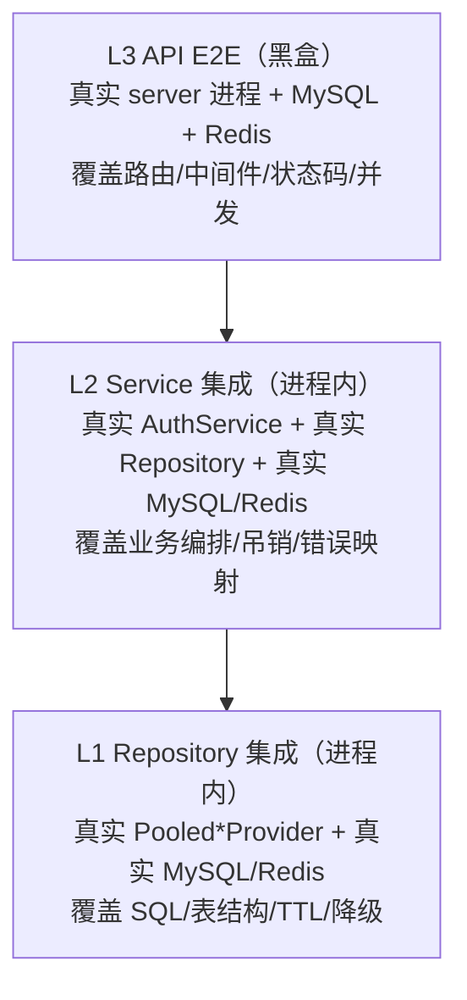

# SDU-Forum 后端集成测试方案

> 适用范围：`/home/wgc/SDU-Forum/backend`（C++17 + Drogon + MySQL 8 + Redis）
>
> 本文档是**集成测试方案**，不包含业务功能开发。文中所有路径、接口、SQL 与行为均基于当前代码勘察结果。
>
> 本文档取代早期 `.trae/documents/后端单元测试与集成测试方案.md` 中已过时的部分：登出/刷新/注销已实现、Redis 已参与鉴权链路、仓储层已有 `IDbConnectionProvider` / `ICacheConnectionProvider` 接缝。

***

## 1. 摘要

### 1.1 目标

为现有认证后端建立一套**可重复、可隔离、可在 CI 运行**的集成测试体系，验证：

1. 仓储层与真实 MySQL / Redis 的契约（SQL、表结构、TTL、缓存降级）；
2. 服务层在真实仓储与真实基础设施上的业务编排（注册、登录、登出、刷新、注销、管理员认证）；
3. HTTP 层黑盒行为（路由、中间件、JSON 契约、状态码、错误码、并发一致性）。

### 1.2 核心决策

| 决策       | 选择                                 | 理由                                                       |
| -------- | ---------------------------------- | -------------------------------------------------------- |
| 测试框架     | 复用现有 doctest 2.4.11                | 已 vendored，零新增依赖                                         |
| 构建/运行    | CMake + CTest，`integration` label  | 与现有 `fast;unit` 体系一致                                     |
| 默认开关     | `SDU_BUILD_INTEGRATION_TESTS=OFF`  | 本地无 MySQL/Redis 时默认 `ctest` 不会误红                         |
| Redis    | **外部 Redis**，通过环境变量注入，独立 db（默认 15） | 不绑定 Docker/本机安装；CI 与本地同一契约                               |
| MySQL    | 复用现有实例与 `testdb`，只使用 `*_it` 表      | 当前账号仅有 `testdb.*` 权限，不建新库                                |
| 隔离       | 独立表 + 独立 Redis db + 唯一测试数据 + 自动清理  | 绝不触碰开发表 `account/blacklist/refresh_tokens/admin_account` |
| HTTP 客户端 | POSIX socket 手写 HTTP/1.1           | 环境无 libcurl 开发头，避免新增依赖                                   |
| 服务进程     | 真实 `sdu_forum_server` 子进程 + 健康检查   | 黑盒，覆盖路由/中间件真实装配                                          |
| 生产代码     | 允许最小修复（P1–P5、P7；P6 为开发库建议）         | 修复配置解析、角色中间件、黑名单 SQL、重复键语义、重复吊销幂等等测试阻塞项                  |

### 1.3 测试分层



* **L1 数量最多**：快速、失败定位精确，是集成测试主体。
* **L2 覆盖跨仓储编排**：token 吊销、刷新语义、账户删除等。
* **L3 只覆盖关键路径与契约**：不全量重复 L1/L2，避免 E2E 脆性与慢。

***

## 2. 现状分析

### 2.1 代码结构与依赖

| 层     | 关键文件                                                                         | 现状                                                      |
| ----- | ---------------------------------------------------------------------------- | ------------------------------------------------------- |
| 入口/装配 | `app/app.cpp`、`app/app_context.cpp`、`app/modules/*/auth_module.cpp`          | 读取 INI、初始化 DB/Redis 连接池、逐层注入、注册路由与中间件                   |
| 路由    | `routes/routes.cpp`                                                          | 用户与管理员的登录/登出/刷新/注销路由                                    |
| 控制器   | `controllers/auth_controller.cpp`、`controllers/admin/auth_controller.cpp`    | 参数校验、调用 Service、统一响应包装                                  |
| 服务    | `services/auth_service.cpp`、`services/admin/auth_service.cpp`                | 登录、注册、登出、刷新、注销、管理员认证                                    |
| 仓储    | `repositories/{account,admin_account,token,blacklist}_repository.cpp`        | 账户/管理员/Token/黑名单 SQL 与缓存                                |
| 中间件   | `middleware/auth_middleware.cpp`、`role_middleware.cpp`、`exception_handler.h` | JWT 校验、吊销检查、角色校验、异常转 JSON                               |
| 基础设施  | `infrastructrue/*`                                                           | DB/Redis 连接池、INI、日志、JWT（HS256）、PBKDF2-HMAC-SHA512       |
| 测试    | `tests/`                                                                     | 4 个 doctest 单元测试，label 为 `fast;unit`；无任何 integration 目标 |

### 2.2 现有测试

* `TokenRepositoryUnit`、`AccountRepositoryUnit`、`AdminAccountRepositoryUnit`、`UtilsUnit` 共 4 个 CTest。
* 全部通过 `sdu_app` 链接，使用 `tests/support/test_doubles.h` 的 Dummy/Stub/Spy/Mock/Fake。
* 单元测试不访问 MySQL/Redis/网络。
* **缺口**：没有真实 SQL/表结构验证、没有 Redis TTL/写回验证、没有跨层编排验证、没有 HTTP 契约验证。

### 2.3 运行时依赖

| 依赖       | 当前环境事实                                                               | 对集成测试的影响                        |
| -------- | -------------------------------------------------------------------- | ------------------------------- |
| MySQL    | 8.0.46 已运行于 `127.0.0.1:3306`；库 `testdb` 存在；账号 `wgc` 仅有 `testdb.*` 权限 | 只能使用 `testdb` 下的 `*_it` 表，不能新建库 |
| Redis    | **未安装/未启动**                                                          | 方案要求外部 Redis，通过环境变量指供           |
| Docker   | Docker Desktop 存在但该 WSL 未启用集成                                        | 不作为本方案前置条件                      |
| libcurl  | 无开发头                                                                 | HTTP 客户端需手写 socket              |
| Shell 环境 | `LD_LIBRARY_PATH` 被工具链污染，`mysql/ctest` 需 `env -u LD_LIBRARY_PATH`    | 验证命令统一加 `env -u`                |

### 2.4 关键接口契约（测试必须锚定）

#### 路由

| 方法     | 路径                                     | 中间件                          |
| ------ | -------------------------------------- | ---------------------------- |
| POST   | `/sdu_forum/api/v1/auth/login`         | 无                            |
| POST   | `/sdu_forum/api/v1/auth/sign-up`       | 无                            |
| POST   | `/sdu_forum/api/v1/auth/logout`        | AccessAuth + UserRole        |
| POST   | `/sdu_forum/api/v1/auth/refresh-token` | RefreshAuth + UserRole       |
| DELETE | `/sdu_forum/api/v1/auth/logoff`        | AccessAuth + UserRole        |
| POST   | `/admin/api/v1/auth/login`             | 无                            |
| POST   | `/admin/api/v1/auth/logout`            | AdminAccessAuth + AdminRole  |
| POST   | `/admin/api/v1/auth/refresh-token`     | AdminRefreshAuth + AdminRole |

#### 响应包装

* 成功：`{"data": {...}}`；创建：`201`；无内容：`204` 空 body。
* 失败：`{"error": {"code": "...", "message": "...", "details": {...}}}`。
* 错误码 → HTTP：`INVALID_JSON/INVALID_PARAM → 400`；`UNAUTHORIZED/INVALID_CREDENTIALS → 401`；`ACCOUNT_BANNED/FORBIDDEN → 403`；`NOT_FOUND → 404`；`CONFLICT → 409`；`DB_ERROR/INTERNAL_ERROR/REDIS_ERROR → 500`。

#### Token 语义（当前实现）

* `Authorization: Bearer <token>`；用户与管理员的 access/refresh 使用不同密钥。
* access token 吊销状态存 Redis（key = `HMAC-SHA256(hash_secret, token)` 的 base64url）；refresh token 吊销状态存 MySQL `refresh_tokens` 表。
* `logout`：校验 refresh JWT → 将 refresh hash 写 DB、access hash 写 Redis → 204。
* `refresh-token`：中间件先拒绝已吊销 refresh；`refreshing=true` 时签发新 refresh 并把旧 refresh hash 写 DB；`refreshing=false` 时只签发新 access。
* `logoff`：删除账户（按 JWT `sub` = public\_id）→ 吊销双 token → 204。
* **重要**：`AuthService::refresh_token` 自身不检查旧 refresh 是否已吊销，吊销拒绝由 `RefreshAuthMiddleware` 完成；L2 只能断言“吊销状态已写入”，拒绝行为放 L3。

### 2.5 勘察发现的阻塞项/缺陷

| 编号 | 位置                                                                | 问题                                                                         | 处理                              |
| -- | ----------------------------------------------------------------- | -------------------------------------------------------------------------- | ------------------------------- |
| D1 | `config/config-dev.ini`                                           | `access_jwt_secret` / `refresh_jwt_secret` 重复出现，管理员密钥键缺失，导致用户密钥被覆盖、管理员密钥为空 | P5 修复开发配置；IT 配置独立且显式            |
| D2 | `infrastructrue/config/app_config.cpp`                            | 未解析 `refresh_token_table`；`admin_account_able` 拼写错误；Redis `passward` 拼写错误  | P1 修复，否则无法用 `*_it` 表隔离          |
| D3 | `repositories/blacklist_repository.cpp`                           | 查询 `user_id`/`end_time`，而表是 `account_id`/`expire_at`；未 JOIN 账户表            | P3 修复；否则黑名单集成用例无法通过             |
| D4 | `services/auth_service.cpp`、`repositories/account_repository.cpp` | 并发注册同一 `user_id` 时唯一键异常映射为 500 DB\_ERROR；顺序重复返回 400 INVALID\_PARAM         | P4 统一为 409 CONFLICT             |
| D5 | `middleware/role_middleware.cpp`                                  | `mcb(...)` 后未 `return`，会继续 `next_cb`，存在双回调风险                               | P2 修复                           |
| D6 | `repositories/token_repository.cpp`                               | Redis 不可用时吊销检查 fail-open（已吊销 access 仍被接受），logout 返回 500                    | 文档记录风险；默认套件要求 Redis 可用；可选故障注入用例 |
| D7 | `docs/db_sqls.md` / `admin_account` 表                             | `admin_account.admin_id` 无唯一约束                                             | IT schema 增加唯一键；建议同步开发表         |
| D8 | `repositories/token_repository.cpp`                               | 并发注销同一 refresh token 时唯一键冲突 → 500                                          | P4/P7 将“重复吊销”视为幂等成功             |

***

## 3. 测试环境与配置契约

### 3.1 环境变量契约

所有环境相关参数通过环境变量注入；INI 已支持 `${VAR:-default}` 展开。

| 变量                      | 默认值         | 说明               |
| ----------------------- | ----------- | ---------------- |
| `SDU_IT_DB_HOST`        | `127.0.0.1` | MySQL 地址         |
| `SDU_IT_DB_PORT`        | `3306`      | MySQL 端口         |
| `SDU_IT_DB_USER`        | `wgc`       | MySQL 用户         |
| `SDU_IT_DB_PASSWORD`    | `123456`    | MySQL 密码         |
| `SDU_IT_DB_NAME`        | `testdb`    | 数据库名（当前账号仅此库权限）  |
| `SDU_IT_REDIS_HOST`     | `127.0.0.1` | 外部 Redis 地址      |
| `SDU_IT_REDIS_PORT`     | `6379`      | Redis 端口         |
| `SDU_IT_REDIS_PASSWORD` | 空           | Redis 密码         |
| `SDU_IT_REDIS_DB`       | `15`        | 专用库号，与开发 db 0 隔离 |

> 外部 Redis 必须允许 `SELECT 15` 与 `FLUSHDB`。若使用托管 Redis 且未开放多个 db，请把 `SDU_IT_REDIS_DB` 指向一个专用实例，或在 CI 中使用独立实例。

### 3.2 `tests/integration/config-it.ini`

```ini
[server]
address = 127.0.0.1
port = 18080
thread_num = 2

[log]
level = WARN
file = ../logs/it-server.log
console = false
max_lines = 10000

[database]
host = ${SDU_IT_DB_HOST:-127.0.0.1}
port = ${SDU_IT_DB_PORT:-3306}
user = ${SDU_IT_DB_USER:-wgc}
password = ${SDU_IT_DB_PASSWORD:-123456}
dbname = ${SDU_IT_DB_NAME:-testdb}
pool_min = 1
pool_max = 4
max_idle_time = 60
connection_timeout_ms = 2000
op_num = 1

[redis]
host = ${SDU_IT_REDIS_HOST:-127.0.0.1}
port = ${SDU_IT_REDIS_PORT:-6379}
password = ${SDU_IT_REDIS_PASSWORD:-}
db = ${SDU_IT_REDIS_DB:-15}

[auth]
issuer = SDU_Forum_IT
access_jwt_secret = it_access_secret_do_not_use_in_prod
refresh_jwt_secret = it_refresh_secret_do_not_use_in_prod
admin_access_secret = it_admin_access_secret_do_not_use_in_prod
admin_refresh_secret = it_admin_refresh_secret_do_not_use_in_prod
hash_secret = it_hash_secret
access_token_minutes = 60
refresh_token_hours = 168
account_table = account_it
blacklist_table = blacklist_it
refresh_token_table = refresh_tokens_it
admin_account_table = admin_account_it
```

> `hash_secret`、`refresh_token_table`、`admin_account_table` 需要在 P1 中补上解析，否则会被忽略并使用默认值。

### 3.3 `tests/integration/schema_it.sql`

与 `docs/db_sqls.md` 保持一致，表名统一加 `_it` 后缀：

| 表                   | 关键列                                                                                                             | 约束                                                |
| ------------------- | --------------------------------------------------------------------------------------------------------------- | ------------------------------------------------- |
| `account_it`        | `id`、`public_id CHAR(24)`、`user_id CHAR(12)`、`password_hash CHAR(64)`、`salt CHAR(32)`、`iterations INT UNSIGNED` | `UNIQUE(public_id)`、`UNIQUE(user_id)`             |
| `blacklist_it`      | `account_id`、`reason`、`expire_at`、`status`                                                                      | `FK account_id → account_it.id ON DELETE CASCADE` |
| `refresh_tokens_it` | `token_hash CHAR(64)`、`expires_at DATETIME`                                                                     | `UNIQUE(token_hash)`                              |
| `admin_account_it`  | `admin_id CHAR(8)`、`password_hash CHAR(64)`、`salt CHAR(32)`、`iterations INT UNSIGNED`                           | `UNIQUE(admin_id)`（新增，修复 D7）                      |

所有 DDL 使用 `CREATE TABLE IF NOT EXISTS`，由测试夹具幂等执行。

### 3.4 隔离与清理规则

1. **表级隔离**：只使用 `account_it`、`blacklist_it`、`refresh_tokens_it`、`admin_account_it`；禁止访问开发表。
2. **Redis 库隔离**：只使用 `SDU_IT_REDIS_DB`（默认 15）；套件开始/结束执行 `FLUSHDB`。
3. **数据命名空间**：
   * 用户 `user_id`：12 位数字，前缀包含进程号（例：`9` + 3 位 pid + 8 位随机数）；
   * 管理员 `admin_id`：8 位，`it` + 6 位随机数字；
   * 密码：用户 `ItPassw0rd!2026`（14 字符），管理员 `ItAdm1n!`（8 字符，符合上限）。
4. **清理**：
   * 套件级：`SET FOREIGN_KEY_CHECKS=0; TRUNCATE account_it/blacklist_it/refresh_tokens_it/admin_account_it; SET FOREIGN_KEY_CHECKS=1;` + `FLUSHDB`。
   * 用例级：`TestScope` RAII 记录本次创建的 user/admin/token hash，析构时按精确值删除（用例失败也会执行）。
5. **禁止**：`TRUNCATE account/blacklist/refresh_tokens/admin_account`；`FLUSHDB` 默认 db 0。

### 3.5 预检与快速失败

`IntegrationEnv::start()` 必须在任何用例前完成：

| 检查                                          | 失败动作                      |
| ------------------------------------------- | ------------------------- |
| 配置文件存在                                      | 打印绝对路径并以退出码 2 终止          |
| MySQL 可连接、`*_it` 表可用（不存在则执行 schema）         | 打印 host/port/db 与错误，退出码 2 |
| Redis `PING` 成功、`SELECT db` 成功、`FLUSHDB` 成功 | 打印 host/port/db 与错误，退出码 2 |
| API 测试端口 `18080` 空闲                         | 打印占用进程提示，退出码 2            |

**不允许静默跳过**：集成测试依赖缺失时必须失败并给出可执行诊断。

***

## 4. 测试工程改造（Proposed Changes）

### 4.1 生产代码最小修复

> 以下修复仅解决测试隔离与已确认缺陷，不新增业务功能。

#### P1 · `infrastructrue/config/app_config.cpp`（必须）

* 新增解析：`m_jwt.hash_secret = string_of(auth, "hash_secret", m_jwt.hash_secret);`
* 新增解析：`m_auth.refresh_token_table = string_of(auth, "refresh_token_table", m_auth.refresh_token_table);`
* 修正键名：`admin_account_able` → `admin_account_table`。
* 修正键名：Redis `passward` → `password`。
* 在 `validate()` 中增加：管理员 access/refresh 密钥非空校验（与 P5 同一次提交）。

**为什么**：没有前三项，IT 配置无法把四张表全部切到 `*_it`，只能污染开发表；没有第四项，外部 Redis 密码永远为空；管理员空密钥是安全隐患。

#### P2 · `middleware/role_middleware.cpp`（必须）

```cpp
if (cur.empty()) { /* log */ mcb(common::error_response(..., "current role is empty")); return; }
if (cur != m_role) { /* log */ mcb(common::error_response(..., "current role is not matched")); return; }
next_cb(std::move(mcb));
```

**为什么**：避免 403 响应后继续执行 handler，导致双回调/未定义行为；负向角色用例才能稳定断言。

#### P3 · `repositories/blacklist_repository.{h,cpp}` + `app/modules/auth_module.cpp`（必须，黑名单用例前置）

* 构造函数增加 `std::string account_table`，与 `blacklist_table` 一样由 `AuthModule` 注入 `config.auth().account_table`。
* 查询改为：

```sql
SELECT a.user_id, b.reason, b.expire_at AS end_time
FROM <blacklist_table> b
JOIN <account_table> a ON b.account_id = a.id
WHERE a.user_id = ?
  AND b.status = 1
  AND (b.expire_at IS NULL OR b.expire_at > NOW())
```

* 保持 `reason`/`end_time` 的 NULL → 空字符串映射。

**为什么**：当前 SQL 与真实表结构不一致，真实库查询必然失败；修复后 L1 可覆盖“生效中/过期/已解除”三种封禁状态。**不启用** `AuthService::login` 中被注释的封禁校验，避免改变登录行为。

#### P4 · 重复键语义统一为 `409 CONFLICT`（必须）

* `services/auth_service.cpp`：`signUp` 查重命中时抛 `AppException(ErrorCode::Conflict, "user_id is already taken")`（原 `InvalidParam`）。
* `repositories/account_repository.cpp`：`insert_account_by_user_id` 捕获 `sql::SQLException`，若 `e.getErrorCode() == 1062` 抛 `AppException(ErrorCode::Conflict, ...)`；否则维持 `DatabaseError`。

**为什么**：顺序重复与并发重复返回一致状态码；`Conflict → 409` 已是现有映射。

#### P5 · `config/config-dev.ini`（必须，与 P1 同提交）

```ini
access_jwt_secret = ${SDU_ACCESS_JWT_SECRET:-dev_access_secret_change_me}
refresh_jwt_secret = ${SDU_REFRESH_JWT_SECRET:-dev_refresh_secret_change_me}
admin_access_secret = ${SDU_ADMIN_ACCESS_JWT_SECRET:-dev_admin_access_secret_change_me}
admin_refresh_secret = ${SDU_ADMIN_REFRESH_JWT_SECRET:-dev_admin_refresh_secret_change_me}
refresh_token_table = refresh_tokens
admin_account_table = admin_account
# 可选：hash_secret = ${SDU_HASH_SECRET:-dev_hash_secret}
```

**为什么**：删除重复键、补齐管理员键；否则 P1 的管理员密钥非空校验会让开发服无法启动。

#### P6 · 开发库 `admin_account` 唯一键（建议，非阻塞 IT）

```sql
ALTER TABLE admin_account ADD UNIQUE KEY uk_admin_id (admin_id);
```

**为什么**：当前无唯一约束，重复 `admin_id` 会导致登录取到不确定行；IT schema 已含唯一键，开发库应同步。

#### P7 · 重复吊销幂等（必须，并发注销用例前置）

* `repositories/token_repository.cpp`：`insert_refresh_token` 捕获 `sql::SQLException`，`getErrorCode() == 1062` 时返回 `true`（该 token 已被吊销，幂等成功）；其余 `SQLException` 仍抛 `DatabaseError`。

**为什么**：并发注销同一 refresh token 时，第二个请求不应 500；吊销是幂等操作。

### 4.2 新增测试目录

```text
backend/tests/integration/
├── CMakeLists.txt
├── config-it.ini
├── schema_it.sql
├── integration_main.cpp              # doctest main + IntegrationEnv 生命周期
├── support/
│   ├── integration_env.h / .cpp      # 配置加载、池初始化、schema、清理、预检
│   ├── mysql_client.h / .cpp         # 直连 JDBC：DDL、查询、TRUNCATE
│   ├── redis_client.h / .cpp         # redis++：PING、FLUSHDB、EXISTS/TTL/GET
│   ├── http_client.h / .cpp          # POSIX socket HTTP/1.1 客户端
│   ├── server_process.h / .cpp       # fork/exec、就绪轮询、优雅退出、日志尾
│   ├── test_data.h / .cpp            # 唯一 ID、seed admin、token hash 计算
│   └── assertions.h                  # 状态码/错误码/JSON/JWT 断言
├── repository/
│   ├── test_account_repository_it.cpp
│   ├── test_admin_account_repository_it.cpp
│   ├── test_token_repository_it.cpp
│   └── test_blacklist_repository_it.cpp
├── service/
│   ├── test_auth_service_it.cpp
│   └── test_admin_auth_service_it.cpp
└── api/
    ├── test_user_auth_api_it.cpp
    └── test_admin_auth_api_it.cpp
```

### 4.3 CMake / CTest 注册

`backend/CMakeLists.txt` 增加开关（默认关闭）：

```cmake
option(SDU_BUILD_INTEGRATION_TESTS
       "Build integration tests (requires MySQL and Redis)" OFF)
```

`backend/tests/CMakeLists.txt` 末尾：

```cmake
if(SDU_BUILD_INTEGRATION_TESTS)
    add_subdirectory(integration)
endif()
```

`backend/tests/integration/CMakeLists.txt`（三个目标，公共设置如下）：

```cmake
set(IT_COMMON
    integration_main.cpp
    support/integration_env.cpp
    support/mysql_client.cpp
    support/redis_client.cpp
    support/http_client.cpp
    support/server_process.cpp
    support/test_data.cpp
)

function(it_target target)
    add_executable(${target} ${IT_COMMON} ${ARGN})
    target_include_directories(${target} PRIVATE
        ${CMAKE_CURRENT_SOURCE_DIR}
        ${CMAKE_CURRENT_SOURCE_DIR}/../..
        ${CMAKE_CURRENT_SOURCE_DIR}/../third_party)
    target_link_libraries(${target} PRIVATE sdu_app sdu_infra Threads::Threads)
    target_compile_definitions(${target} PRIVATE
        SDU_FORUM_IT_CONFIG="${CMAKE_CURRENT_SOURCE_DIR}/config-it.ini"
        SDU_FORUM_IT_SCHEMA="${CMAKE_CURRENT_SOURCE_DIR}/schema_it.sql")
    add_test(NAME ${target} COMMAND ${target})
    set_tests_properties(${target} PROPERTIES
        LABELS "integration;needs-mysql;needs-redis;slow"
        TIMEOUT 300
        RESOURCE_LOCK sdu_forum_it
        WORKING_DIRECTORY ${CMAKE_SOURCE_DIR})
endfunction()

it_target(IntegrationRepository
    repository/test_account_repository_it.cpp
    repository/test_admin_account_repository_it.cpp
    repository/test_token_repository_it.cpp
    repository/test_blacklist_repository_it.cpp)
it_target(IntegrationService
    service/test_auth_service_it.cpp
    service/test_admin_auth_service_it.cpp)
it_target(IntegrationApi
    api/test_user_auth_api_it.cpp
    api/test_admin_auth_api_it.cpp)

target_compile_definitions(IntegrationApi PRIVATE
    SDU_FORUM_SERVER_BIN="$<TARGET_FILE:sdu_forum_server>")
add_dependencies(IntegrationApi sdu_forum_server)
```

> 三个目标都使用 `RESOURCE_LOCK sdu_forum_it`，保证共享表/Redis db 的用例串行，避免互相 `TRUNCATE`。

### 4.4 夹具设计

#### `IntegrationEnv`（单例，进程级）

* `start()`：
  1. 读取 `SDU_FORUM_IT_CONFIG`；
  2. `infra::AppConfig::instance().load(path)`；
  3. **L1/L2**：用 `DatabaseConfig` 初始化 `dcp::ConnectionPool::instance(MySQL)`；用 `RedisConfig` 以 `init(cfg, 1, 4, 60, 2000, 1)` 初始化 `rcp::RedisConnectionPool::instance()`，避免默认按 CPU 核数创建大量外部 Redis 连接；
  4. **API**：不初始化应用连接池；启动 `ServerProcess`；
  5. 建立测试侧直连 `MysqlClient` / `RedisClient`；
  6. 幂等执行 `schema_it.sql`；
  7. `reset_all()`。
* `reset_all()`：TRUNCATE 四张 `*_it` 表 + `FLUSHDB`。
* `stop()`：停止 server（API）、`destroy_instance` 连接池、关闭直连。
* 提供 `db()`、`redis()`、`config()`、`server()`、`base_url()`。

#### `ServerProcess`

* `fork()` + `execve()`：子进程 `setpgid(0,0)`、`prctl(PR_SET_PDEATHSIG, SIGTERM)`、stdout/stderr 重定向到 `logs/it-server.log`。
* 父进程轮询 `connect(127.0.0.1:18080)`，每 50ms 一次，最多 15s；同时 `waitpid(WNOHANG)` 检测子进程提前退出。
* 就绪失败时输出日志尾 200 行。
* `stop()`：`kill(-pid, SIGTERM)` → 最多 5s → `SIGKILL` → `waitpid`。
* 注册 `atexit` 与 `SIGINT/SIGTERM` 处理，防止测试进程异常时遗留 server。

#### `HttpClient`

* 方法：`send(method, path, headers, body)`；`get/post/del` 便捷封装。
* 发送 `HTTP/1.1` + `Host` + `Content-Type: application/json` + `Content-Length` + `Connection: close`。
* `SO_RCVTIMEO`/`SO_SNDTIMEO` = 10s；`connect` 使用非阻塞 + `poll` 超时。
* 解析状态行、头（大小写不敏感）、`Content-Length` 与 `chunked`；返回 `{status, headers, body}`。
* 不依赖 libcurl。

#### `TestData`

* `unique_user_id()`：12 位数字（pid 片段 + 随机）。
* `unique_admin_id()`：`it` + 6 位数字。
* `seed_admin(id, password, iterations=1000)`：用 `infra::hash_password` 生成 hash/salt，直插 `admin_account_it`。
* `token_hash(token)`：`utils::hmac_sha256_base64url(config.jwt().hash_secret, token)`。
* `sign_user_access(...)` / `sign_user_refresh(...)`：用 `infra::TokenSigner` 伪造合法/过期 token，用于负向用例。

#### `assertions.h`

* `require_status(resp, 200/201/204/400/401/409/405/404)`
* `require_error(resp, status, "INVALID_JSON" | ...)`
* `require_data(resp)` 返回 `Json::Value`
* `require_jwt(token, expected_sub, expected_role, expected_issuer)`
* 断言只锚定**状态码 + 错误码 + 字段结构**，不断言 message 文案。

### 4.5 断言与命名约定

* 测试套件：`TEST_SUITE("Integration/Repository/Account")` 等。
* 用例名：`<主体> <行为> <条件>`，如 `insert then find returns stored credential fields`。
* AAA：Arrange → Act → Assert；每例只保留一个失败理由。
* 时间/TTL 断言使用 ±5s 容差；时间统一 UTC（`utils::timestamp_to_string` 使用 `gmtime`）。
* 不使用固定 `sleep`；仅轮询就绪。
* 每个用例自建数据；不依赖执行顺序（API 套件中的 token 链除外，需在单个 `TEST_CASE` 内顺序执行）。

***

## 5. 用例矩阵

### 5.1 L1 · 仓储–基础设施

#### AccountRepository

| #    | 用例                                                 | 步骤                           | 断言                                                    |
| ---- | -------------------------------------------------- | ---------------------------- | ----------------------------------------------------- |
| R-A1 | insert then find returns stored credential fields  | 插入记录 → 查询                    | 返回 record；`id>0`；public\_id/hash/salt/iterations 完全一致 |
| R-A2 | find returns nullopt for unknown user\_id          | 查询不存在用户                      | `nullopt`                                             |
| R-A3 | duplicate user\_id maps to Conflict                | 同 user\_id 插入两次              | 第二次抛 `AppException`，`code()==Conflict`（P4）            |
| R-A4 | delete removes row and second delete returns false | 插入 → 删除 → 再删除                | 第一次 true 且行不存在；第二次 false                              |
| R-A5 | prepared statement neutralizes injection payload   | 查询 `000000000000' OR '1'='1` | `nullopt`，不抛 500                                      |

#### AdminAccountRepository

| #    | 用例                                         | 步骤               | 断言                                  |
| ---- | ------------------------------------------ | ---------------- | ----------------------------------- |
| R-D1 | seeded admin can be found                  | seed → find      | id>0；hash/salt/iterations 一致        |
| R-D2 | find returns nullopt for unknown admin\_id | 查询不存在            | `nullopt`                           |
| R-D3 | duplicate admin\_id is rejected            | 同 admin\_id 插入两次 | 第二次抛 `DatabaseError`（IT schema 唯一键） |

#### TokenRepository

| #    | 用例                                                         | 步骤                          | 断言                                                                                   |
| ---- | ---------------------------------------------------------- | --------------------------- | ------------------------------------------------------------------------------------ |
| R-T1 | insert\_refresh persists row and find hits DB              | 插入 → find                   | true；DB 行 `expires_at == timestamp_to_string(exp)`；Redis key 存在且 TTL≈`refresh_ttl_s` |
| R-T2 | find\_refresh returns true on cache hit without DB         | 只写 Redis，不写 DB              | true（证明未访问 DB）                                                                       |
| R-T3 | find\_refresh returns false and writes no cache on DB miss | 查询不存在 hash                  | false；Redis key 不存在                                                                  |
| R-T4 | insert\_access writes Redis with configured TTL            | 插入 access                   | true；key 存在；TTL≈`access_ttl_s`；find\_access true                                     |
| R-T5 | find\_refresh rewrites cache after key eviction            | 插入 DB → 删除 Redis key → find | true；key 被重新写入，TTL≈`refresh_ttl_s`                                                   |

#### BlacklistRepository（P3 后）

| #    | 用例                                 | 步骤                                             | 断言                                  |
| ---- | ---------------------------------- | ---------------------------------------------- | ----------------------------------- |
| R-B1 | active permanent ban returns entry | account + blacklist(status=1, expire\_at=NULL) | 返回 entry；`reason` 一致；`end_time==""` |
| R-B2 | active timed ban returns end\_time | expire\_at=NOW()+1d                            | 返回 entry；`end_time` 非空              |
| R-B3 | expired ban returns nullopt        | expire\_at=NOW()-1d                            | `nullopt`                           |
| R-B4 | inactive ban returns nullopt       | status=0                                       | `nullopt`                           |
| R-B5 | unknown user returns nullopt       | 无记录                                            | `nullopt`                           |
| R-B6 | empty reason maps to empty string  | reason=''                                      | `entry.reason == ""`                |

> `reason` 在真实 schema 中为 `NOT NULL DEFAULT ''`，`is_null("reason")` 分支当前不可达；R-B6 只验证空串映射，NULL 分支由代码审查覆盖。

### 5.2 L2 · 服务–仓储

> 构造：真实 `AccountRepository` / `BlacklistRepository` / `AdminAccountRepository` / `TokenRepository` + 真实 `Pooled*Provider` + IT `JwtConfig`。

#### AuthService

| #     | 用例                                                   | 断言                                                                                |
| ----- | ---------------------------------------------------- | --------------------------------------------------------------------------------- |
| S-U1  | signUp stores hashed credential                      | 返回 `usr_[0-9A-Za-z]{20}`；DB 中 hash≠明文、salt 32 位、`verify_password` 通过              |
| S-U2  | signUp duplicate throws Conflict                     | 抛 `Conflict`（P4）                                                                  |
| S-U3  | login returns verifiable dual tokens                 | access/refresh 可被对应 `TokenSigner` 验证；`sub==public_id`；`role=="user"`；exp≈now+TTL  |
| S-U4  | login rejects unknown and wrong password identically | 均抛 `InvalidCredentials`                                                           |
| S-U5  | logout revokes both tokens                           | `find_refresh_token(hash(refresh))==true`；`find_access_token(hash(access))==true` |
| S-U6  | second logout with same refresh throws Unauthorized  | 抛 `Unauthorized`                                                                  |
| S-U7  | refresh with refreshing=true revokes old refresh     | 新双 token 可验证；DB 中存在旧 refresh hash；Redis 中存在 access hash                           |
| S-U8  | refresh with refreshing=false returns access only    | `result.refresh_token` 为空、`refresh_token_exp==0`；旧 refresh **未**写 DB              |
| S-U9  | logoff deletes account and revokes tokens            | 账户行不存在；双 token 已吊销；再次 login 抛 `InvalidCredentials`                                |
| S-U10 | expired/wrong-secret refresh throws Unauthorized     | 抛 `Unauthorized`                                                                  |
| S-U11 | blacklist rows cascade on logoff                     | 预置 blacklist 行；logoff 后该行不存在                                                      |

#### AdminAuthService

| #    | 用例                                                 | 断言                                                      |
| ---- | -------------------------------------------------- | ------------------------------------------------------- |
| S-D1 | admin login returns admin-role tokens              | `sub==admin_id`；`role=="admin"`；双 token 可被管理员 signer 验证 |
| S-D2 | wrong admin password throws InvalidCredentials     | 抛 `InvalidCredentials`                                  |
| S-D3 | admin logout revokes both tokens                   | DB/Redis 状态与用户侧一致                                       |
| S-D4 | admin refresh refreshing=false returns access only | refresh 字段为空；旧 refresh 未吊销                              |
| S-D5 | cross-realm tokens do not verify                   | 用户 token 用管理员 signer 验证失败；反之亦然                          |

### 5.3 L3 · API E2E（黑盒）

> 套件启动一次 server；套件级 reset；seeded admin；通过 API 创建用户。

#### A. 路由与请求格式

| #  | 请求                                                       | 期望                             |
| -- | -------------------------------------------------------- | ------------------------------ |
| A1 | `GET /sdu_forum/api/v1/auth/login`                       | 405                            |
| A2 | `POST /sdu_forum/api/v1/auth/logoff`                     | 405                            |
| A3 | `GET /unknown`                                           | 404                            |
| A4 | `POST /auth/login` body `{`                              | 400 `INVALID_JSON`             |
| A5 | `POST /auth/login` body `{}`                             | 400 `INVALID_JSON`（缺 user\_id） |
| A6 | `POST /auth/login` body `{"user_id":123,"password":"x"}` | 400 `INVALID_PARAM`            |
| A7 | 空 user\_id / 空 password                                  | 400 `INVALID_PARAM`            |
| A8 | user\_id 65 字符 / password 129 字符                         | 400 `INVALID_PARAM`            |

#### B. 注册 / 登录

| #  | 用例            | 期望                                                           |
| -- | ------------- | ------------------------------------------------------------ |
| B1 | 合法注册          | 201；`data.public_id` 匹配 `^usr_[0-9A-Za-z]{20}$`；DB 行存在且密码为哈希 |
| B2 | 重复注册          | 409 `CONFLICT`（P4）                                           |
| B3 | 合法登录          | 200；`token_type=="Bearer"`；6 个字段齐全；两个 exp 为数值且≈now+TTL       |
| B4 | 错误密码 / 不存在账号  | 401 `INVALID_CREDENTIALS`                                    |
| B5 | user\_id 前后空白 | 被 trim；使用 trim 后的账号可登录                                       |
| B6 | 注入式 user\_id  | 401 `INVALID_CREDENTIALS`，不出现 500                            |
| B7 | JWT 结构        | header `alg=HS256,typ=JWT`；payload `iss/sub/role` 正确         |

#### C. 受保护端点（用户）

| #   | 用例                                    | 期望                                                           |
| --- | ------------------------------------- | ------------------------------------------------------------ |
| C1  | `/auth/logout` 无 Authorization        | 401 `UNAUTHORIZED`                                           |
| C2  | `Basic xxx` 或空 Bearer                 | 401 `UNAUTHORIZED`                                           |
| C3  | 伪造/篡改 access token                    | 401 `UNAUTHORIZED`                                           |
| C4  | 过期 access token（ttl=-1 伪造）            | 401 `UNAUTHORIZED`                                           |
| C5  | 合法 logout                             | 204，空 body；access 进 Redis 吊销集、refresh 进 DB                   |
| C6  | 重放已吊销 access token                    | 401 `UNAUTHORIZED`                                           |
| C7  | 重放已吊销 refresh token                   | 401 `UNAUTHORIZED`                                           |
| C8  | refresh `refreshing=true`             | 200；返回新 access+refresh；旧 refresh 重放失败                        |
| C9  | refresh `refreshing=false`            | 200；`refresh_token==""`、`refresh_token_exp==0`；旧 refresh 仍可用 |
| C10 | refresh 缺 `refreshing`/`access_token` | 400 `INVALID_PARAM`                                          |
| C11 | logoff（DELETE）合法                      | 204；账户被删除；再次登录 401；双 token 失效                                |
| C12 | logoff 无 auth                         | 401 `UNAUTHORIZED`                                           |

#### D. 管理员

| #  | 用例                            | 期望                                           |
| -- | ----------------------------- | -------------------------------------------- |
| D1 | 管理员登录                         | 200；`data.admin_id`；6 字段；JWT `role=="admin"` |
| D2 | 管理员错误密码                       | 401 `INVALID_CREDENTIALS`                    |
| D3 | 管理员 logout                    | 204；双 token 吊销；重放 401                        |
| D4 | 管理员 refresh `refreshing=true` | 200；旧 refresh 重放 401                         |
| D5 | 用户 token 访问管理员端点              | 401 `UNAUTHORIZED`                           |
| D6 | 管理员 token 访问用户端点              | 401 `UNAUTHORIZED`                           |

#### E. 并发与一致性（P4/P7 后）

| #  | 用例                       | 期望                                                           |
| -- | ------------------------ | ------------------------------------------------------------ |
| E1 | 8 线程并发注册同一 user\_id      | 恰好 1 个 201，其余 409；DB 恰好 1 行                                  |
| E2 | 8 线程并发登录同一账号             | 全部 200；每个 token 均可验证；无 5xx（同一秒内 JWT 载荷相同，token 可能相同，不作唯一性断言） |
| E3 | 2 线程并发注销同一 refresh token | 无 5xx；最终双 token 均已吊销（P7 幂等）                                  |

#### F. 故障注入（默认不跑，`DISABLED` 或独立 target）

| #  | 用例                           | 期望                                                                     |
| -- | ---------------------------- | ---------------------------------------------------------------------- |
| F1 | server 指向不可用 Redis（`port=1`） | 登录仍 200；logout 返回 500 `DB_ERROR`；已吊销 access 仍被接受（fail-open，记录为安全权衡 D6） |

> F1 需要第二个 server 端口与 `config-it-noredis.ini`；默认不注册到 `ctest -L integration`，避免误伤共享 Redis。

### 5.4 覆盖边界（明确不测）

| 项             | 原因                                   |
| ------------- | ------------------------------------ |
| 黑名单登录拦截       | `AuthService::login` 中该校验被注释；不改变业务行为 |
| Redis 主从/故障转移 | 不在应用职责内                              |
| 前端            | `frontend/` 为空目录                     |
| 压测/稳定性        | 属于性能测试，另行设计                          |
| 密码哈希算法强度      | 由单元测试覆盖，集成只验证“存储值非明文且可校验”            |

***

## 6. 实施顺序

1. **P1 + P5**：补配置解析、修正键名、修复开发配置；编译并手动启动 server 冒烟。
2. **P2**：角色中间件 `return`；回归现有单元测试。
3. **P3 + P7 + P4**：黑名单 SQL、重复吊销幂等、重复注册 409；补对应单元测试或调整现有断言。
4. 新增 `tests/integration/support/`：`IntegrationEnv`、`MysqlClient`、`RedisClient`、`TestData`、`assertions.h`。
5. 新增 `schema_it.sql` 与 `config-it.ini`；验证 schema 幂等与预检失败诊断。
6. 新增 L1 四个仓储用例文件；`ctest -R IntegrationRepository` 跑绿。
7. 新增 L2 两个服务用例文件；`ctest -R IntegrationService` 跑绿。
8. 新增 `HttpClient`、`ServerProcess`、L3 两个 API 用例文件；`ctest -R IntegrationApi` 跑绿。
9. 加入 CI 命令与 JUnit 输出；最后跑全量 `unit + integration`。

***

## 7. 验证步骤

```bash
# 0) 环境变量（按实际外部 Redis 填写）
export SDU_IT_DB_HOST=127.0.0.1 SDU_IT_DB_PORT=3306
export SDU_IT_DB_USER=wgc SDU_IT_DB_PASSWORD=123456 SDU_IT_DB_NAME=testdb
export SDU_IT_REDIS_HOST=127.0.0.1 SDU_IT_REDIS_PORT=6379
export SDU_IT_REDIS_PASSWORD= SDU_IT_REDIS_DB=15

# 1) 预检
nc -z "$SDU_IT_DB_HOST" "$SDU_IT_DB_PORT"
nc -z "$SDU_IT_REDIS_HOST" "$SDU_IT_REDIS_PORT"

# 2) 建表（夹具也会幂等执行；手工执行便于排障）
env -u LD_LIBRARY_PATH mysql -h"$SDU_IT_DB_HOST" -P"$SDU_IT_DB_PORT" \
  -u"$SDU_IT_DB_USER" -p"$SDU_IT_DB_PASSWORD" "$SDU_IT_DB_NAME" \
  < backend/tests/integration/schema_it.sql

# 3) 构建（集成测试默认关闭，需显式开启）
env -u LD_LIBRARY_PATH cmake -S backend -B backend/build \
  -DCMAKE_BUILD_TYPE=Debug -DSDU_BUILD_INTEGRATION_TESTS=ON
env -u LD_LIBRARY_PATH cmake --build backend/build -j"$(nproc)"

# 4) 单元回归
env -u LD_LIBRARY_PATH ctest --test-dir backend/build -L unit --output-on-failure

# 5) 集成测试
env -u LD_LIBRARY_PATH ctest --test-dir backend/build -L integration --output-on-failure

# 6) 单独定位
env -u LD_LIBRARY_PATH ctest --test-dir backend/build -R IntegrationApi --output-on-failure
```

### 通过标准

* 单元测试全绿，且不访问 MySQL/Redis。
* L1/L2/L3 全绿；无 5xx（除显式故障注入用例外）。
* 套件结束后：
  * `account_it/blacklist_it/refresh_tokens_it/admin_account_it` 为空；
  * 外部 Redis 的 IT db 为空；
  * `pgrep -f sdu_forum_server` 无残留；
  * `backend/logs/it-server.log` 无未处理异常。
* 手动冒烟：`sdu_forum_server` 用开发配置启动，登录接口行为不变（除重复注册由 400 变为 409）。

***

## 8. CI 设计

### 8.1 推荐形态（服务容器 / 外部实例二选一）

```yaml
# 伪代码，落地时写入 CI 平台
services:
  mysql:
    image: mysql:8.0
    env: { MYSQL_ROOT_PASSWORD: root, MYSQL_DATABASE: testdb, MYSQL_USER: wgc, MYSQL_PASSWORD: 123456 }
    ports: ["3306:3306"]
    options: --health-cmd="mysqladmin ping -h127.0.0.1 -uroot -proot" --health-interval=5s
  redis:
    image: redis:7
    ports: ["6379:6379"]
    options: --health-cmd="redis-cli ping" --health-interval=5s

steps:
  - apply schema
  - cmake -DSDU_BUILD_INTEGRATION_TESTS=ON
  - cmake --build
  - ctest -L unit --output-on-failure
  - ctest -L integration --output-on-failure --output-junit it-results.xml
  - upload artifacts: it-results.xml, backend/logs/it-server.log
```

### 8.2 注意事项

* 生产密钥绝不进入 CI；IT 配置使用固定测试密钥并明确标注 `do_not_use_in_prod`。
* MySQL/Redis 使用 healthcheck，避免测试启动时环境未就绪。
* 并行分片时，每个分片必须使用独立的 `SDU_IT_DB_NAME` 或独立的 Redis db，不能共享 `*_it` 表。
* 集成测试只在显式开启时构建/注册，单元测试保持默认快速。

***

## 9. 假设、风险与边界

| # | 假设/风险                                | 缓解                                       |
| - | ------------------------------------ | ---------------------------------------- |
| 1 | 外部 Redis 可用且允许 `SELECT 15`/`FLUSHDB` | 预检快速失败；CI 使用专用实例                         |
| 2 | MySQL 账号仅有 `testdb.*` 权限             | 不建库；只建 `*_it` 表                          |
| 3 | PBKDF2 默认 150000 次，注册/登录较慢           | 用例数量受控；seed 管理员使用 1000 次（只影响 seed，不影响用户） |
| 4 | 时间/TTL 断言可能抖动                        | ±5s 容差；统一 UTC                            |
| 5 | 并发用例可能暴露当前实现的竞态                      | P4/P7 先修复；E1/E3 以“无 5xx + 最终状态”断言        |
| 6 | Redis 不可用时吊销 fail-open（D6）           | 默认套件要求 Redis；F1 单独记录，不在主套件断言安全语义         |
| 7 | 角色中间件曾双回调（D5）                        | P2 修复后加负向角色用例                            |
| 8 | 开发环境 `LD_LIBRARY_PATH` 污染            | 所有构建/测试命令加 `env -u LD_LIBRARY_PATH`      |
| 9 | 旧文档与当前实现不一致                          | 本文档为准；旧文档不再维护                            |

***

## 10. 附录：关键默认值与常量

| 项                 | 值                                            | 来源                                |
| ----------------- | -------------------------------------------- | --------------------------------- |
| access token TTL  | 3600s（60 分钟）                                 | `config-dev.ini` / IT 配置          |
| refresh token TTL | 604800s（168 小时）                              | 同上                                |
| 用户角色              | `user`                                       | `infra::kUserRole`                |
| 管理员角色             | `admin`                                      | `infra::kAdminRole`               |
| 密码哈希              | PBKDF2-HMAC-SHA512，32 字节，盐 16 字节，默认 150000 次 | `security/password_hasher.cpp`    |
| token 存储 hash     | HMAC-SHA256 + base64url                      | `utils::hmac_sha256_base64url`    |
| 用户 ID 上限          | 64 字符（Controller）                            | `controllers/auth_controller.cpp` |
| 密码上限              | 128 字符（用户）/ 8 字符（管理员）                        | 两个 Controller                     |
| 用户 ID 列           | `CHAR(12)`                                   | `docs/db_sqls.md`                 |
| 管理员 ID 列          | `CHAR(8)`                                    | `scripts/create_admin_account.py` |
| 响应成功包装            | `{"data": ...}`                              | `common/api_response.h`           |
| 响应失败包装            | `{"error":{"code","message","details"}}`     | 同上                                |
