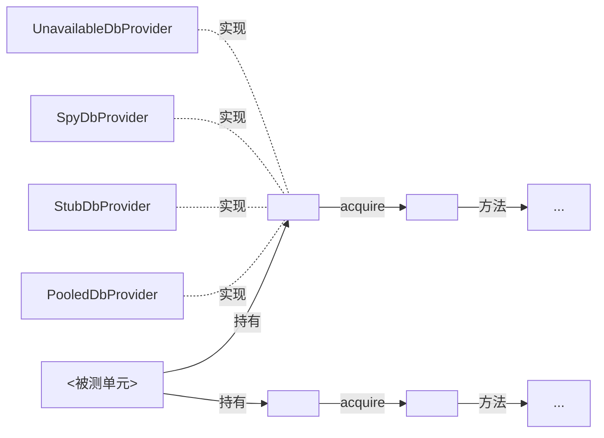

# Skill：模块测试替身与用例设计生成器

> **用途**：给定一个待测单元（类/模块），自动产出 6 张格式统一的图表，使你**可直接按表构造替身、按表编写用例**，不遗漏分支、不误用替身类型。
>
> **适用对象**：任何遵循"被测单元 → 接口 ← 生产实现 / 测试替身"链路的模块（本项目的 Repository、Service、Adapter 层均适用）。
>
> **调用方式**：把本 skill 连同被模块的**源代码 + 依赖接口头文件 + 现有 `test_doubles.h`** 一起交给 AI，或按本流程自行手工执行。

---

## 0. 执行前须知：你在做的是"设计"而不是"写代码"

**测试替身不是凭空造出来的，是从断言句里倒推出来的。** 本 skill 的核心纪律：

> **先写断言句（Then），再选替身类型，再设计 State 字段，最后才写代码。**

任何跳过"断言句"直接选替身的行为，都会导致后续用例含糊、替身万能化、测试假绿。

---

## 1. 输入清单

执行本 skill 之前，必须收集齐以下四份材料（缺一不可）：

| 编号 | 输入 | 形式 | 用途 |
|---|---|---|---|
| I1 | 被测单元源文件（`.h` + `.cpp`） | 代码 | 提取成员函数、构造参数、调用链 |
| I2 | 被测单元依赖的**接口头文件** | 代码 | 提取接口方法、返回类型、语义 |
| I3 | 现有测试替身头文件（如 `test_doubles.h`） | 代码 | 判断可复用/需新增 |
| I4 | 现有测试用例（如有） | 代码 | 判断覆盖现状与缺口 |

> 若接口头文件尚未存在（接缝未建立），**先停下**——按"接缝优先"原则，先重构生产代码抽出接口，再回来执行本 skill。没有接缝，替身无处注入。

---

## 2. 执行流程（6 步固定顺序）

```
Step 1  画依赖地形图          → 表 T1
Step 2  列行为覆盖矩阵        → 表 T2
Step 3  为每格写断言句        → 表 T3（并入选型）
Step 4  选替身类型+设计State  → 表 T4
Step 5  产出用例骨架          → 表 T5
Step 6  汇总文件产出          → 表 T6
```

每一步必须**完整输出对应图表**后再进入下一步，不允许合并或跳过。

---

## 3. 输出格式（6 张固定图表）

### 表 T1 · 依赖地形图

**目的**：把"被测单元与外部世界的每一次握手"列出来，作为构造替身的施工图。

**输出格式**：

```
被测单元: <单元名>
构造注入: <依赖1接口名>, <依赖2接口名>, ...
```



**明细表**（必须完整列出每一个方法）：

| 依赖接口 | 提供者 | 方法 | 返回/副作用 | 调用点（SUT 的哪个方法调它） |
|---|---|---|---|---|
| `IDbConnection` | `Stub/Spy/...` | `prepare_statement` | 无 | `insert_refresh_token` |
| `IDbConnection` | ... | `set_string` | 无 | `insert_refresh_token` / `find_refresh_token` |
| `IDbConnection` | ... | `set_datetime` | 无 | `insert_refresh_token` |
| `IDbConnection` | ... | `execute_query` | 返回 `IResultSet` | `find_refresh_token` |
| `IDbConnection` | ... | `execute_update` | 返回 `int` | `insert_refresh_token` |
| `ICacheConnection` | ... | `get` | `optional<string>` | `find_access_token` / `find_refresh_token` |
| `ICacheConnection` | ... | `set` | `bool` | `insert_access_token` / `find_refresh_token` |

---

### 表 T2 · 行为覆盖矩阵

**目的**：把 SUT 的每个方法在"正常/边界/异常/交互"四个维度上铺开，作为覆盖率清单。**每一格必须显式标记"要测"或"不测（理由）"**，不允许留空。

**输出格式**：

| 方法 | 正常 | 边界 | 异常 | 交互 | 优先级 |
|---|---|---|---|---|---|
| `find_refresh_token` | 查到一行 → true | 无行 → false；缓存命中 → 跳过 db | db 不可用 / SQL 抛异常 / cache 不可用 | 查询 SQL、绑定 hash、回写 cache | P0 |
| `insert_refresh_token` | 插入 1 行 → true | 0 行 → false | db 不可用 / SQL 抛异常 | INSERT SQL、绑定 hash+datetime | P0 |
| `find_access_token` | 缓存命中 → true | 未命中 → false | cache 不可用 → RedisError | 无 | P0 |
| `insert_access_token` | set 成功 → true | set 拒绝 → false | cache 不可用 → RedisError | TTL 转发 | P1 |
| `hash_secret` | 返回配置值 | — | — | 无 | P1 |

**每格展开为具体用例**（这一层是"用例清单"而非"矩阵"，但仍属于 T2 的延伸）：

| # | 用例名（方法 行为 场景） | 覆盖格子 | 优先级 |
|---|---|---|---|
| 1 | `hash_secret returns configured secret` | hash_secret/正常 | P1 |
| 2 | `find_access_token returns true on cache hit` | find_access_token/正常 | P0 |
| 3 | `find_access_token returns false on cache miss` | find_access_token/边界 | P0 |
| 4 | `find_access_token throws RedisError when cache unavailable` | find_access_token/异常 | P0 |
| 5 | `insert_access_token stores token with configured ttl` | insert_access_token/正常+交互 | P0 |
| 6 | `insert_access_token returns false when cache rejects write` | insert_access_token/边界 | P1 |
| 7 | `insert_access_token throws RedisError when cache unavailable` | insert_access_token/异常 | P0 |
| 8 | `insert_refresh_token binds hash and expiry datetime` | insert_refresh_token/正常+交互 | P0 |
| 9 | `insert_refresh_token returns false when no row inserted` | insert_refresh_token/边界 | P0 |
| 10 | `insert_refresh_token throws DatabaseError when db unavailable` | insert_refresh_token/异常 | P0 |
| 11 | `insert_refresh_token throws DatabaseError on sql failure` | insert_refresh_token/异常 | P0 |
| 12 | `find_refresh_token returns true on cache hit without db access` | find_refresh_token/正常（缓存命中） | P0 |
| 13 | `find_refresh_token loads from db and writes back to cache` | find_refresh_token/正常+交互 | P0 |
| 14 | `find_refresh_token returns false and skips cache on db miss` | find_refresh_token/边界 | P0 |
| 15 | `find_refresh_token queries table and binds token hash` | find_refresh_token/交互 | P0 |
| 16 | `find_refresh_token throws RedisError when cache unavailable` | find_refresh_token/异常 | P0 |
| 17 | `find_refresh_token throws DatabaseError when db unavailable` | find_refresh_token/异常 | P0 |
| 18 | `find_refresh_token throws DatabaseError on sql failure` | find_refresh_token/异常 | P0 |

---

### 表 T3 · 断言句清单

**目的**：把 T2 中每个用例的"Then"写出来。**断言句即替身选型的输入**，一句一个断言主角。

**输出格式**：

| # | 用例名 | 断言句（一句话，动词开头） | 断言主角 | 是否含交互断言 |
|---|---|---|---|---|
| 1 | `hash_secret ...` | 断言返回配置字符串 | 返回值 | 否 |
| 2 | `find_access ... hit` | 断言返回 true | 返回值 | 否 |
| 5 | `insert_access ... ttl` | 断言写入后缓存存在该 key 且 TTL=600 | 写入后状态 | 否 |
| 8 | `insert_refresh ... binds` | 断言 SQL 文本、2 个绑定参数与 1 次 update | 交互契约 | 是 |
| 13 | `find_refresh ... writes back` | 断言缓存被写回一次，key/value/TTL 均正确 | 交互契约 | 是 |
| 15 | `find_refresh ... queries` | 断言 SELECT SQL、绑定参数、1 次 query | 交互契约 | 是 |

**规则**：
- 断言句里出现"返回…/抛出…" → 主角是返回值/异常 → **Stub**
- 出现"调用…/绑定…/写入…后" → 主角是交互或状态 → **Spy/Mock** 或 **Fake**
- 出现"之后还能读到" → 主角是状态 → **Fake**

---

### 表 T4 · 替身选型与 State 设计

**目的**：输出构造替身的完整规格。每行 = 一个 (替身, 字段)，可直接交给编码者。

**输出格式（两个子表）**：

#### T4-A · 替身类型决策表

| # | 用例名 | DB 替身（配置） | Cache 替身（配置） | 断言点 | 优先级 |
|---|---|---|---|---|---|
| 1 | `hash_secret ...` | **Dummy** | **Dummy** | 返回字符串 | P1 |
| 2 | `find_access hit` | **Dummy** | **Fake**（预置 key） | 返回 true | P0 |
| 3 | `find_access miss` | **Dummy** | **Fake**（空） | 返回 false | P0 |
| 4 | `find_access cache unavailable` | **Dummy** | **Unavailable** | 抛 RedisError | P0 |
| 5 | `insert_access stores ttl` | **Dummy** | **Fake** | 状态：`contains=true, ttl=600` | P0 |
| 6 | `insert_access rejects write` | **Dummy** | **Stub**（`set_result=false`） | 返回 false | P1 |
| 7 | `insert_access cache unavailable` | **Dummy** | **Unavailable** | 抛 RedisError | P0 |
| 8 | `insert_refresh binds` | **Spy**（`update_rows=1`） | **Dummy** | SQL、参数、调用次数 | P0 |
| 9 | `insert_refresh no row` | **Stub**（`update_rows=0`） | **Dummy** | 返回 false | P0 |
| 10 | `insert_refresh db unavailable` | **Unavailable** | **Dummy** | 抛 DatabaseError | P0 |
| 11 | `insert_refresh sql failure` | **Stub**（`throw_on_update=true`） | **Dummy** | 抛 DatabaseError | P0 |
| 12 | `find_refresh cache hit` | **Dummy** | **Fake**（预置 key） | 返回 true，且 db 零调用 | P0 |
| 13 | `find_refresh writes back` | **Stub**（`has_row=true`） | **Mock**（`expect_set(...)`） | `cache.verify()` | P0 |
| 14 | `find_refresh db miss` | **Stub**（`has_row=false`） | **Mock**（空 expected_sets） | 返回 false + `verify()` | P0 |
| 15 | `find_refresh queries` | **Spy**（`has_row=true`） | **Fake** | SELECT SQL + 绑定 | P0 |
| 16 | `find_refresh cache unavailable` | **Dummy** | **Unavailable** | 抛 RedisError | P0 |
| 17 | `find_refresh db unavailable` | **Unavailable** | **Fake** | 抛 DatabaseError | P0 |
| 18 | `find_refresh sql failure` | **Stub**（`throw_on_query=true`） | **Fake** | 抛 DatabaseError | P0 |

**"为什么是 Dummy 而不是 Stub"必须能在表里读出**：DB 列出现 Dummy 的行，SUT 在本行为里**没有 db 调用路径**（如用例 1–7、12、16）。若某行本该 Dummy 却被误写成 Stub，进入 T4-B 检查——Stub 的 State 字段无人读取，即为选错。

#### T4-B · State 字段设计表

| 替身名 | 实现接口 | State 字段 | 类型 | 默认值 | 旋钮/仪表盘 | 驱动哪些用例（#） |
|---|---|---|---|---|---|---|
| `StubDbState` | `IDbConnection` | `has_row` | `bool` | `false` | 旋钮 | 13, 14 |
| | | `update_rows` | `int` | `1` | 旋钮 | 9 |
| | | `throw_on_query` | `bool` | `false` | 旋钮 | 18 |
| | | `throw_on_update` | `bool` | `false` | 旋钮 | 11 |
| `SpyDbState` | `IDbConnection` | `prepared_sql` | `string` | `""` | 仪表盘 | 8, 15 |
| | | `string_params` | `vector<pair<u16,string>>` | `{}` | 仪表盘 | 8, 15 |
| | | `datetime_params` | `vector<pair<u16,string>>` | `{}` | 仪表盘 | 8 |
| | | `prepare_calls` | `int` | `0` | 仪表盘 | 8, 15 |
| | | `query_calls` | `int` | `0` | 仪表盘 | 15 |
| | | `update_calls` | `int` | `0` | 仪表盘 | 8 |
| `FakeCacheState` | `ICacheConnection` | `store` | `unordered_map<string,string>` | `{}` | 双向 | 2, 3, 5, 12, 15, 17, 18 |
| | | `ttls` | `unordered_map<string,int>` | `{}` | 双向 | 2, 5 |
| `StubCacheState` | `ICacheConnection` | `get_result` | `optional<string>` | `nullopt` | 旋钮 | （按需扩展） |
| | | `set_result` | `bool` | `true` | 旋钮 | 6 |
| `MockCacheState` | `ICacheConnection` | `expected_get_calls` | `int` | `1` | 旋钮 | 13, 14 |
| | | `expected_sets` | `vector<ExpectedSet>` | `{}` | 旋钮 | 13 |
| | | `set_calls` | `vector<SetCall>` | `{}` | 仪表盘 | 13, 14 |
| | | `get_calls` | `int` | `0` | 仪表盘 | 13, 14 |
| | | `get_result` | `optional<string>` | `nullopt` | 旋钮 | 13, 14 |
| | | `set_result` | `bool` | `true` | 旋钮 | 13 |

**自检规则**：
- **每个 State 字段必须至少被一个用例的"旋钮"或"断言"引用**。无引用的字段 = 冗余设计，删掉。
- **每个"旋钮"字段必须出现在 T4-A 至少一行的"配置"里**。否则说明该异常分支未覆盖。
- **Dummy/Unavailable 没有 State 字段**（它们的职责是"不存在"和"返回 nullptr"，不需要旋钮）。

---

### 表 T5 · 用例骨架表

**目的**：把 T4 落成可直接写的代码骨架。AAA 三段 + Verify 四段固定。

**输出格式**：

| # | 用例名 | Arrange | Act | Assert | Verify |
|---|---|---|---|---|---|
| 8 | `insert_refresh_token binds hash and expiry datetime` | `SpyDbProvider db; db.connection().state().update_rows=1;` `DummyCacheProvider cache;` `TokenRepository repo(db, cache, cfg);` | `repo.insert_refresh_token({"refresh-hash", 1700000000});` | `CHECK(true)`；`CHECK(prepared_sql==...)`；`REQUIRE(string_params.size()==1)`；`CHECK(...)` | 无 |
| 13 | `find_refresh_token loads from db and writes back to cache` | `StubDbProvider db; db.connection().state().has_row=true;` `MockCacheProvider cache; cache.mock().expect_set("refresh-hash","refresh-hash",3600);` `repo(db, cache, cfg);` | `repo.find_refresh_token("refresh-hash");` | `CHECK(true)` | `cache.mock().verify();` |
| 18 | `find_refresh_token throws DatabaseError on sql failure` | `StubDbProvider db; db.connection().state().throw_on_query=true;` `FakeCacheProvider cache;` `repo(db, cache, cfg);` | `repo.find_refresh_token("refresh-hash");` | `CHECK(throws_with_code(..., DatabaseError));` | 无 |

**骨架模板**（每个用例都套此模板）：

```
TEST_CASE("<方法 行为 场景>")
{
    // Arrange: <一行注释说明本用例的意图>
    <替身1> db; db.connection().state().<旋钮> = <值>;
    <替身2> cache; cache.<入口>().<旋钮> = <值>;
    <SUT> repo(db, cache, make_config());

    // Act
    <单次调用>;

    // Assert
    <返回值断言>;
    <仪表盘断言>;

    // Verify（仅 Mock 用例）
    cache.mock().verify();
}
```

---

### 表 T6 · 文件产出清单

**目的**：告诉执行者"这次要新增/修改哪些文件"，避免遗漏注册或重复造轮子。

**输出格式**：

| 文件 | 动作 | 内容 |
|---|---|---|
| `tests/support/test_doubles.h` | **追加** | `StubAccountState`、`StubAccountConnection`、`SpyAccountConnection`、`FakeAccountConnection`、`MockAccountConnection` + 对应 Provider |
| `tests/support/test_doubles.h` | **复用** | `UnavailableDbProvider`、`UnavailableCacheProvider`、`StubResultSet`（跨模块通用，不重复定义） |
| `tests/unit/repositories/test_account_repository.cpp` | **新建** | T5 全部用例 |
| `tests/CMakeLists.txt` | **追加** | `add_executable` + `add_test` + `LABELS "fast;unit"` + `TIMEOUT 10` |

**复用规则**：
- 接口相同的 State（如 `StubResultSet`、`Unavailable*`）→ 复用，不重复造；
- 接口新增方法（如 Account 需要 `set_int`）→ **扩展接口 + 扩展 State**，不新建一套；
- 同接口多态替身（Stub/Spy/Fake/Mock）→ 全部保留，因为它们的语义不可互替。

---

## 4. 质量门禁（产出前自检 12 项）

产出 6 张图表后，逐条自检。任一项为 ❌ 则回到对应 Step 修正。

| # | 检查项 | 通过标准 |
|---|---|---|
| G1 | T1 覆盖了 SUT 依赖的**每一个**接口方法 | 无遗漏 |
| G2 | T2 的每一格都标了"要测"或"不测（理由）" | 无空格 |
| G3 | T2 每个"要测"格在 T3 都有对应用例 | 无遗漏 |
| G4 | T3 每条断言句都以动词开头，且只断言一个主角 | 无"且/并/同时" |
| G5 | T4-A 每行都有一个明确的主角替身（非 Dummy） | 非"全 Mock" |
| G6 | T4-A 出现 Dummy 的行，SUT 无该依赖调用路径 | Dummy 真不被访问 |
| G7 | T4-B 每个 State 字段至少被一个用例引用 | 无冗余字段 |
| G8 | T4-B 每个"旋钮"字段至少被一个用例配置 | 无未覆盖分支 |
| G9 | 每个用例名遵循 `<方法> <行为> <场景>` 命名 | 全部统一 |
| G10 | 异常用例断言错误码，不断言文案 | `ErrorCode::X`，不是字符串 |
| G11 | 每个 Mock 用例以 `verify()` 收尾 | 无遗漏 |
| G12 | 没有用例同时使用"Mock + Fake 断言"（要拆成两条） | 每条一个失败理由 |

---

## 5. 常见陷阱（执行者必须内化）

| # | 陷阱 | 本 skill 的防御机制 |
|---|---|---|
| 1 | 一个用例断言十件事 | G3 强制一格一用例；G12 强制一条一个失败理由 |
| 2 | 所有依赖都用 Mock | G5 强制有主角；G6 强制 Dummy 真不被访问 |
| 3 | 断言日志或错误文案 | G10 用错误码断言 |
| 4 | 用 Stub 代替 Fake 做状态验证 | G8 检查"写后状态"类断言必须由 Fake 承担 |
| 5 | 给 Dummy 加断言 | G6 反向检查 Dummy 的调用路径 |
| 6 | 替身 State 字段冗余 | G7 强制字段被引用 |
| 7 | 异常分支未覆盖 | G8 检查旋钮字段全覆盖 |
| 8 | 用例名含糊 | G9 强制 `<方法> <行为> <场景>` |

---

## 6. 图表之间的依赖关系（执行者理解用）

```
T1 依赖地形图
   │  提供"方法清单"与"调用点"
   ▼
T2 行为覆盖矩阵
   │  提供"用例清单"与"覆盖格"
   ▼
T3 断言句清单
   │  提供"断言主角"
   ▼
T4 替身选型 + State 设计
   │  提供"每行替身类型 + 字段规格"
   ▼
T5 用例骨架
   │  提供"可直接抄写的 AAA 模板"
   ▼
T6 文件产出清单
   │  提供"落地动作"
   ▼
   编码 → 跑绿 → 变异检查
```

**关键纪律**：**严禁跳过 T3 直接做 T4**。T3 是"从断言到替身"的桥；跳过 T3，T4 的选型就变成凭感觉，后续用例必塌。

---

## 7. 使用示例（调用方视角）

用户对 AI 说：

> "调用此 skill，为 `AccountRepository`（`src/repositories/account_repository.{h,cpp}`，依赖 `connection_provider.h` 与 `tests/support/test_doubles.h`）产出 6 张图表。"

AI 按 Step 1–6 依次输出 T1–T6，最后附一段"**首推落地顺序**"建议（例如："先建 T4-B 中 3 个新 State 字段 → 跑通用例 8（Spy）→ 再加 13（Mock）→ 最后补异常用例 10/11"）。

调用方拿到图表后**直接按 T4-B 写 `test_doubles.h` 追加、按 T5 抄用例、按 T6 改 CMake**，无需再做设计决策。

---

## 8. 一页速查卡（打印/贴墙）

```
【触发】拿到新模块 → 调 skill
【准备】I1 源码 / I2 接口 / I3 现有替身 / I4 现有测试
【产出】T1 地形 → T2 矩阵 → T3 断言句 → T4 选型+State → T5 骨架 → T6 文件
【铁律】
  ① 先写断言句，再选替身
  ② 一个用例一个失败理由
  ③ Dummy 真不被访问，Stub 只答返回值，Fake 答状态，Spy 事后取证，Mock 事前契约
  ④ 异常断言错误码，不断言文案
  ⑤ State 字段无引用即删，旋钮无配置即漏
  ⑥ Provider 用"原型 + acquire + shared_ptr<State>"
【出口】12 项质量门禁全过 → 落地编码
```

---

**Skill 版本**：v1.0（与 `test_doubles.h` + `test_token_repository.cpp` 当前实现对齐）
**维护者**：wgc
**下次触发条件**：任何新增 Repository / Service / Adapter 模块需要补测试时，直接复用本 skill。