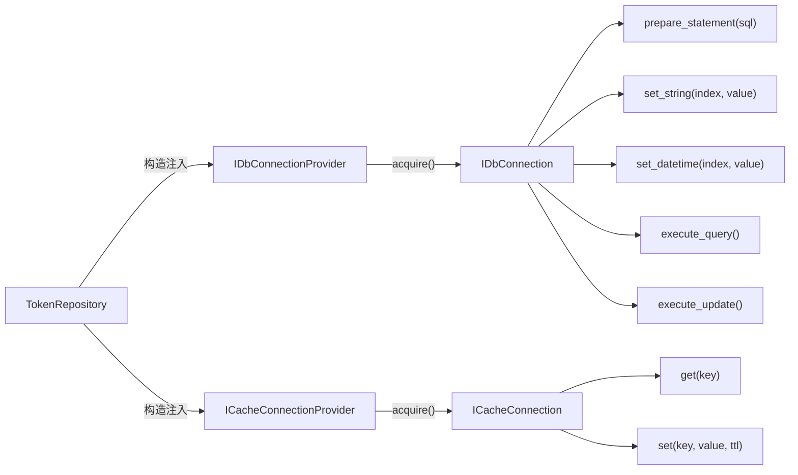

# SDU-Forum 后端单元测试设计手册

> 本文档用于记录**所有单元**的测试替身设计与用例设计，是活文档，不是审查报告。
>
> 当前收录：
>
> - `repository::TokenRepository`
> - `utils::timestamp_to_string`
>
> 后续新增模块时，在对应位置追加模块章节，并更新第 1 节的模块索引。

## 1. 模块索引

| 模块 | 测试可执行文件 | CTest 名称 | 用例数 | 使用替身 |
|---|---|---|---:|---|
| `repository::TokenRepository` | `test_token_repository` | `TokenRepositoryUnit` | 34 | Dummy / Stub / Spy / Mock / Fake / Unavailable |
| `utils::timestamp_to_string` | `test_utils` | `UtilsUnit` | 1 | 无（纯函数） |

- 测试框架：doctest 2.4.11
- 构建系统：CMake + CTest
- 单元测试标签：`fast;unit`
- 默认超时：10 秒
- 单元测试不得访问 MySQL、Redis、网络

## 2. 测试框架约定

### 2.1 目录结构

```text
backend/tests/
├── CMakeLists.txt
├── third_party/
│   └── doctest.h
├── support/
│   ├── test_main.cpp
│   └── test_doubles.h
├── unit/
│   ├── repositories/
│   │   └── test_token_repository.cpp
│   └── utils/
│       └── test_utils.cpp
└── docs/
    └── tests.md
```

### 2.2 命名与结构约定

- 测试文件：`unit/<层>/test_<单元>.cpp`
- 测试套件：`TEST_SUITE("<单元名>")`
- 用例名：`<方法> <行为> <场景>`，例如 `find_xxx returns false on cache miss`
- 用例结构：Arrange → Act → Assert；Mock 用例追加 Verify
- 异常断言：断言 `common::ErrorCode`，不断言错误文案
- 一个用例只保留一个失败理由；需要同时验证返回值和交互时，拆成两个用例

### 2.3 五类替身的使用边界

| 替身 | 用途 | 断言对象 | 本项目中的实现 |
|---|---|---|---|
| Dummy | 占满构造参数，不被访问 | 无 | `DummyDbProvider`、`DummyCacheProvider` |
| Stub | 提供固定返回值或固定异常 | 被测对象的返回值/状态 | `StubDbConnection`、`StubCacheConnection`、`Unavailable*Provider` |
| Spy | 记录调用参数与顺序 | 交互是否发生、顺序 | `SpyDbConnection` |
| Mock | 预置期望并统一校验 | 交互契约本身 | `MockCacheConnection` |
| Fake | 真实但轻量的实现 | 端到端状态 | `FakeCacheConnection` |

## 3. 全局测试替身清单

所有替身定义在 [test_doubles.h](../support/test_doubles.h)。

### 3.1 替身总表

| 替身 | 实现接口 | 角色 | 核心能力 |
|---|---|---|---|
| `StubResultSet` | `dcp::IResultSet` | Stub | 只控制 `next()` 的行数，列读取返回默认值 |
| `StubDbConnection` | `repository::IDbConnection` | Stub | 固定查询行数、更新行数、异常开关、空结果集 |
| `SpyDbConnection` | `repository::IDbConnection` | Spy | 记录 SQL、绑定参数、调用次数与事件顺序 |
| `StubCacheConnection` | `repository::ICacheConnection` | Stub | 固定 `set` 返回值、`get/set` 异常开关 |
| `FakeCacheConnection` | `repository::ICacheConnection` | Fake | 内存键值存储 + TTL 记录 |
| `MockCacheConnection` | `repository::ICacheConnection` | Mock | 预置 `set` 期望，记录 `get/set` 调用与顺序，`verify()` 校验 |
| `DummyDbProvider` | `repository::IDbConnectionProvider` | Dummy | 返回 `nullptr`，表示“不应被访问” |
| `DummyCacheProvider` | `repository::ICacheConnectionProvider` | Dummy | 返回 `nullptr`，表示“不应被访问” |
| `UnavailableDbProvider` | `repository::IDbConnectionProvider` | Stub | 返回 `nullptr`，表示“被访问但连接不可用” |
| `UnavailableCacheProvider` | `repository::ICacheConnectionProvider` | Stub | 返回 `nullptr`，表示“被访问但连接不可用” |
| `StubDbProvider` | `repository::IDbConnectionProvider` | Stub Provider | 原型 + 共享 State |
| `SpyDbProvider` | `repository::IDbConnectionProvider` | Spy Provider | 原型 + 共享 State |
| `StubCacheProvider` | `repository::ICacheConnectionProvider` | Stub Provider | 原型 + 共享 State |
| `FakeCacheProvider` | `repository::ICacheConnectionProvider` | Fake Provider | 原型 + 共享 State |
| `MockCacheProvider` | `repository::ICacheConnectionProvider` | Mock Provider | 原型 + 共享 State |

### 3.2 `StubResultSet`

| 成员 | 类型 | 默认值 | 作用 |
|---|---|---|---|
| `m_row_count` | `int` | 构造参数，默认 0 | `next()` 返回 true 的行数 |
| `m_seen` | `int` | 0 | 已读取行数 |

行为：

- `next()`：`m_seen < m_row_count` 时返回 true，并递增 `m_seen`
- `close()`：空实现
- 所有 `get_*`、`is_null`：返回 0、空字符串、false
- 当前只用于“是否存在一行”的判断，不用于列值断言

### 3.3 数据库替身

#### `StubDbState`

| 字段 | 类型 | 默认值 | 作用 |
|---|---|---|---|
| `has_row` | `bool` | `false` | `execute_query()` 返回 0 行或 1 行 |
| `update_rows` | `int` | `1` | `execute_update()` 返回的受影响行数 |
| `throw_on_query` | `bool` | `false` | `execute_query()` 抛 `sql::SQLException` |
| `throw_on_update` | `bool` | `false` | `execute_update()` 抛 `sql::SQLException` |
| `return_null_result_set` | `bool` | `false` | `execute_query()` 返回 `nullptr` |
| `throw_on_prepare` | `bool` | `false` | `prepare_statement()` 抛 `sql::SQLException` |
| `throw_on_set_string` | `bool` | `false` | `set_string()` 抛 `sql::SQLException` |
| `throw_on_set_datetime` | `bool` | `false` | `set_datetime()` 抛 `sql::SQLException` |

#### `StubDbConnection`

- `prepare_statement`：`throw_on_prepare` 为 true 时抛异常
- `set_string`：`throw_on_set_string` 为 true 时抛异常
- `set_datetime`：`throw_on_set_datetime` 为 true 时抛异常
- `execute_query`：按 `throw_on_query`、`return_null_result_set`、`has_row` 依次处理
- `execute_update`：按 `throw_on_update`、`update_rows` 处理
- 不记录 SQL 和绑定参数；需要交互断言时使用 `SpyDbConnection`

#### `SpyDbState`

| 字段 | 类型 | 默认值 | 作用 |
|---|---|---|---|
| `has_row` | `bool` | `false` | 查询返回 1 行或 0 行 |
| `update_rows` | `int` | `1` | 更新返回的受影响行数 |
| `prepared_sql` | `std::string` | 空 | 最近一次预处理的 SQL |
| `string_params` | `vector<pair<uint16_t,string>>` | 空 | 字符串绑定参数，保留下标与顺序 |
| `datetime_params` | `vector<pair<uint16_t,string>>` | 空 | 时间绑定参数，保留下标与顺序 |
| `prepare_calls` | `int` | 0 | 预处理次数 |
| `query_calls` | `int` | 0 | 查询次数 |
| `update_calls` | `int` | 0 | 更新次数 |
| `events` | `vector<string>` | 空 | 调用顺序：`prepare`、`bind_string`、`bind_datetime`、`query`、`update` |

#### `SpyDbConnection`

- 每个方法先写入 `events`，再记录对应参数或次数
- `execute_query()` 不支持空结果集和异常；这些场景使用 `StubDbConnection`
- `string_params`、`datetime_params` 使用 `vector<pair>`，用于断言绑定下标和顺序

### 3.4 缓存替身

#### `FakeCacheState`

| 字段 | 类型 | 默认值 | 作用 |
|---|---|---|---|
| `store` | `unordered_map<string,string>` | 空 | 缓存键值 |
| `ttls` | `unordered_map<string,int>` | 空 | 每个键的 TTL |

#### `FakeCacheConnection`

- `get(key)`：存在返回对应值，不存在返回 `nullopt`
- `set(key, value, ttl)`：写入 `store` 和 `ttls`，固定返回 true
- `put(key, value, ttl)`：测试预置数据
- `contains(key)`：判断键是否存在
- `ttl_of(key)`：返回 TTL，不存在返回 -1
- 不能模拟写入失败；写入失败场景使用 `StubCacheConnection`

#### `StubCacheState`

| 字段 | 类型 | 默认值 | 作用 |
|---|---|---|---|
| `throw_on_get` | `bool` | `false` | `get()` 抛 `std::runtime_error` |
| `throw_on_set` | `bool` | `false` | `set()` 抛 `std::runtime_error` |
| `set_result` | `bool` | `true` | `set()` 的固定返回值 |

#### `StubCacheConnection`

- `get()`：`throw_on_get` 为 true 时抛异常，否则返回 `nullopt`
- `set()`：`throw_on_set` 为 true 时抛异常，否则返回 `set_result`
- 不保存数据；需要“写入后可读”时使用 `FakeCacheConnection`

#### `MockCacheState`

| 字段 | 类型 | 默认值 | 作用 |
|---|---|---|---|
| `expected_get_calls` | `int` | 1 | 期望的 `get` 次数 |
| `expected_sets` | `vector<ExpectedSet>` | 空 | 期望的 `set` 序列 |
| `set_calls` | `vector<SetCall>` | 空 | 实际 `set` 序列 |
| `get_calls` | `int` | 0 | 实际 `get` 次数 |
| `get_result` | `optional<string>` | `nullopt` | `get` 返回的缓存值 |
| `set_result` | `bool` | `true` | `set` 返回结果 |
| `throw_on_get` | `bool` | `false` | `get` 是否抛异常 |
| `throw_on_set` | `bool` | `false` | `set` 是否抛异常 |
| `last_get_key` | `string` | 空 | 最近一次读取的 key |
| `events` | `vector<string>` | 空 | 调用顺序：`get`、`set` |

#### `MockCacheConnection`

`SetCall` 与 `ExpectedSet` 均包含 `key`、`value`、`ttl_seconds` 三个字段。

- `expect_set(key, value, ttl)`：追加一条写入期望
- `get(key)`：记录 `last_get_key`、`events`、`get_calls`，按需抛异常，返回 `get_result`
- `set(key, value, ttl)`：记录 `events`、`set_calls`，按需抛异常，返回 `set_result`
- `verify()`：
  - 断言 `get_calls == expected_get_calls`
  - 断言 `set_calls` 与 `expected_sets` 数量一致
  - 逐条断言 key、value、ttl 一致

### 3.5 Provider 约定

所有 Provider 都采用“原型 + 共享 State”模式：

```cpp
class XxxProvider final : public IXxxProvider
{
public:
    XxxConnection& connection();  // 或 fake() / mock()
    std::unique_ptr<IXxx> acquire() override;
private:
    XxxConnection m_prototype;
};
```

- `acquire()` 返回新的连接句柄
- 新句柄与原型共享 `shared_ptr<State>`
- 测试通过 `connection()`、`fake()`、`mock()` 读写 State
- `Dummy*` 与 `Unavailable*` 没有 State，`acquire()` 直接返回 `nullptr`

### 3.6 替身与用例引用矩阵

| 替身 | 被哪些用例使用 |
|---|---|
| `DummyDbProvider` | 1, 2, 3, 4, 5, 6, 7, 12, 21, 22, 27, 28, 29, 30, 31 |
| `DummyCacheProvider` | 1, 8, 9, 10, 11, 25, 26, 32 |
| `UnavailableDbProvider` | 10, 17 |
| `UnavailableCacheProvider` | 4, 7, 16, 33 |
| `StubDbConnection` / `StubDbProvider` | 9, 11, 13, 14, 18, 19, 23, 24, 25, 26, 33, 34 |
| `SpyDbConnection` / `SpyDbProvider` | 8, 15, 16, 20, 32 |
| `FakeCacheConnection` / `FakeCacheProvider` | 2, 3, 5, 12, 15, 17, 18, 19, 27, 28, 29 |
| `StubCacheConnection` / `StubCacheProvider` | 6, 21, 22, 23, 34 |
| `MockCacheConnection` / `MockCacheProvider` | 13, 14, 20, 24, 30, 31 |
| `StubResultSet` | 由 `StubDbConnection`、`SpyDbConnection` 内部使用 |

## 4. TokenRepository

### 4.1 被测单元与依赖

被测文件：

- [token_repository.h](../../repositories/token_repository.h)
- [token_repository.cpp](../../repositories/token_repository.cpp)

依赖接口：

- [connection_provider.h](../../repositories/connection_provider.h)



| 依赖接口 | 方法 | 返回/副作用 | 调用点 |
|---|---|---|---|
| `IDbConnection` | `prepare_statement` | 无 | `insert_refresh_token`、`find_refresh_token` |
| `IDbConnection` | `set_string` | 无 | `insert_refresh_token`、`find_refresh_token` |
| `IDbConnection` | `set_datetime` | 无 | `insert_refresh_token` |
| `IDbConnection` | `execute_query` | 返回 `IResultSet` | `find_refresh_token` |
| `IDbConnection` | `execute_update` | 返回受影响行数 | `insert_refresh_token` |
| `ICacheConnection` | `get` | 返回 `optional<string>` | `find_access_token`、`find_refresh_token` |
| `ICacheConnection` | `set` | 返回 bool | `insert_access_token`、`find_refresh_token` |

### 4.2 行为覆盖矩阵

| 方法 | 正常 | 边界 | 异常 | 交互 |
|---|---|---|---|---|
| `hash_secret` | 返回配置值 | 不测：配置由上层保证 | 不测：返回 const 引用，无异常路径 | 不适用 |
| `find_access_token` | 缓存命中 → true | 未命中 → false；空字符串值 → true | 连接不可用、`get` 抛异常 → 返回 false | 只读，不写缓存 |
| `insert_access_token` | 写入成功 → true | 写入被拒 → false；TTL=0 原样转发 | 连接不可用、`set` 抛异常 → 返回 false | key/value 均为 token_hash；TTL 转发 |
| `insert_refresh_token` | 插入 1 行 → true | 0 行 → false | 连接不可用、prepare/bind/update 异常 → DatabaseError | INSERT SQL、绑定下标、事件顺序 |
| `find_refresh_token` | 缓存命中 → true；DB 命中 → true + 回写 | DB 无行 → false；回写失败/回写抛异常仍 true | 缓存不可用/`get` 异常 → 降级 DB；SQL/空结果集 → DatabaseError | SELECT SQL、绑定、回写契约、负向交互 |

### 4.3 用例目录

> 编号是本文档的设计编号，与 [test_token_repository.cpp](../unit/repositories/test_token_repository.cpp) 中的 `TEST_CASE` 一一对应；下表按方法分组展示，不要求与文件行序一致。

#### 配置读取

| # | 用例名 | 替身配置 | 断言 |
|---|---|---|---|
| 1 | `hash_secret returns configured secret` | DummyDb + DummyCache | 返回 `"unit-test-secret"` |

#### access_token 缓存读写

| # | 用例名 | 替身配置 | 断言 |
|---|---|---|---|
| 2 | `find_access_token returns true on cache hit` | DummyDb + FakeCache，预置 key | 返回 true |
| 3 | `find_access_token returns false on cache miss` | DummyDb + FakeCache，空 | 返回 false |
| 4 | `find_access_token returns false when cache unavailable` | DummyDb + UnavailableCache | 返回 false |
| 21 | `find_access_token returns false when cache get throws` | DummyDb + StubCache，`throw_on_get=true` | 返回 false |
| 28 | `find_access_token returns true for empty-string value` | DummyDb + FakeCache，值为空字符串 | 返回 true |
| 31 | `find_access_token does not write cache` | DummyDb + MockCache，空期望 | 返回 false；`set_calls` 为空；`last_get_key` 正确；事件仅 `get`；`verify()` |

#### access_token 写入

| # | 用例名 | 替身配置 | 断言 |
|---|---|---|---|
| 5 | `insert_access_token stores token with configured ttl` | DummyDb + FakeCache | 返回 true；key 存在；TTL=600 |
| 6 | `insert_access_token returns false when cache rejects write` | DummyDb + StubCache，`set_result=false` | 返回 false |
| 7 | `insert_access_token returns false when cache unavailable` | DummyDb + UnavailableCache | 返回 false |
| 22 | `insert_access_token returns false when cache set throws` | DummyDb + StubCache，`throw_on_set=true` | 返回 false |
| 27 | `insert_access_token stores the exact token value` | DummyDb + FakeCache | 缓存 value 等于 token_hash |
| 29 | `insert_access_token forwards zero ttl` | DummyDb + FakeCache，`access_ttl_s=0` | 返回 true；TTL=0 |

#### refresh_token 数据库写入

| # | 用例名 | 替身配置 | 断言 |
|---|---|---|---|
| 8 | `insert_refresh_token binds hash and expiry datetime` | SpyDb，`update_rows=1` + DummyCache | 返回 true；INSERT SQL 正确；字符串参数下标 1；时间参数下标 2；时间字符串正确；`update_calls=1`；事件序列正确 |
| 9 | `insert_refresh_token returns false when no row inserted` | StubDb，`update_rows=0` + DummyCache | 返回 false |
| 10 | `insert_refresh_token throws DatabaseError when db unavailable` | UnavailableDb + DummyCache | 抛 DatabaseError |
| 11 | `insert_refresh_token throws DatabaseError on sql failure` | StubDb，`throw_on_update=true` + DummyCache | 抛 DatabaseError |
| 25 | `insert_refresh_token throws DatabaseError when prepare fails` | StubDb，`throw_on_prepare=true` + DummyCache | 抛 DatabaseError |
| 26 | `insert_refresh_token throws DatabaseError when binding fails` | StubDb，`throw_on_set_string=true` + DummyCache | 抛 DatabaseError |
| 32 | `insert_refresh_token does not execute query` | SpyDb，`update_rows=1` + DummyCache | 返回 true；`query_calls=0`；事件序列不含 `query` |

#### refresh_token 查询与缓存回写

| # | 用例名 | 替身配置 | 断言 |
|---|---|---|---|
| 12 | `find_refresh_token returns true on cache hit without db access` | DummyDb + FakeCache，预置 key | 返回 true |
| 13 | `find_refresh_token loads from db and writes back to cache` | StubDb，`has_row=true` + MockCache，`expect_set` | 返回 true；`verify()`；事件 `get → set` |
| 14 | `find_refresh_token returns false and skips cache on db miss` | StubDb，`has_row=false` + MockCache，空期望 | 返回 false；`verify()` |
| 15 | `find_refresh_token queries table and binds token hash` | SpyDb，`has_row=true` + FakeCache，空 | 返回 true；SELECT SQL 正确；绑定下标 1；`query_calls=1`；事件 `prepare → bind_string → query` |
| 16 | `find_refresh_token falls back to db when cache unavailable` | SpyDb，`has_row=true` + UnavailableCache | 返回 true；`prepare_calls=1`；`query_calls=1`；SELECT SQL 正确 |
| 17 | `find_refresh_token throws DatabaseError when db unavailable` | UnavailableDb + FakeCache，空 | 抛 DatabaseError |
| 18 | `find_refresh_token throws DatabaseError on sql failure` | StubDb，`throw_on_query=true` + FakeCache | 抛 DatabaseError |
| 19 | `find_refresh_token throws DatabaseError when query result is null` | StubDb，`return_null_result_set=true` + FakeCache | 抛 DatabaseError |
| 20 | `find_refresh_token falls back to db when cache get throws` | SpyDb，`has_row=true` + MockCache，`throw_on_get=true`，`expect_set` | 返回 true；`prepare_calls=1`；`query_calls=1`；`verify()`；事件 `get → set` |
| 23 | `find_refresh_token returns true when cache write-back throws` | StubDb，`has_row=true` + StubCache，`throw_on_set=true` | 返回 true |
| 24 | `find_refresh_token returns true when cache write-back fails` | StubDb，`has_row=true` + MockCache，`set_result=false` | 返回 true；`verify()` |
| 30 | `find_refresh_token does not write cache on cache hit` | DummyDb + MockCache，`get_result=hash` | 返回 true；`set_calls` 为空；`last_get_key` 正确；事件仅 `get`；`verify()` |
| 33 | `find_refresh_token returns false from db fallback when cache unavailable` | StubDb，`has_row=false` + UnavailableCache | 返回 false |
| 34 | `find_refresh_token returns false from db fallback when cache get throws` | StubDb，`has_row=false` + StubCache，`throw_on_get=true` | 返回 false |

### 4.4 交互契约

#### `insert_refresh_token`

- SQL：`INSERT INTO refresh_token_it (token_hash,expires_at) VALUES (?,?)`
- 字符串参数：下标 1，值 `token_hash`
- 时间参数：下标 2，值 `utils::timestamp_to_string(exp_at)`
- 事件顺序：`prepare → bind_string → bind_datetime → update`
- 返回：`execute_update()` 的行数大于 0 时为 true

#### `find_refresh_token`

- SQL：`SELECT id FROM refresh_token_it WHERE token_hash=?`
- 字符串参数：下标 1，值 `token_hash`
- 事件顺序：`prepare → bind_string → query`
- 缓存不可用：直接降级到 DB；DB 有行 true，无行 false；不写缓存
- 缓存命中：直接返回 true，不访问 DB，不写缓存
- 缓存未命中且 DB 有行：写回缓存，key/value 均为 `token_hash`，TTL 为 `refresh_ttl_s`
- 缓存未命中且 DB 无行：返回 false，不写缓存
- 缓存 `get` 抛异常：捕获并记录日志，按缓存未命中处理，降级到 DB；DB 有行 true（并尝试回写），无行 false
- 缓存回写语义：
  - `set` 返回 false：best-effort，仍返回 true
  - `set` 抛异常：捕获并记录日志，仍返回 true

#### `insert_access_token`

- 缓存 key：`token_hash`
- 缓存 value：`token_hash`
- TTL：`access_ttl_s`
- 返回：`set` 的返回值
- 缓存不可用或 `set` 抛异常：返回 false

#### `find_access_token`

- 缓存 key：`token_hash`
- 返回：`get` 是否有值，空字符串也算命中
- 缓存不可用或 `get` 抛异常：返回 false

### 4.5 错误映射

| 场景 | 错误码/结果 |
|---|---|
| DB 连接不可用 | `common::ErrorCode::DatabaseError` |
| `prepare_statement` / `set_string` / `set_datetime` / `execute_query` / `execute_update` 抛 `sql::SQLException` | `common::ErrorCode::DatabaseError` |
| `execute_query()` 返回 `nullptr` | `common::ErrorCode::DatabaseError` |
| `find_refresh_token` 缓存连接不可用 | 降级 DB，不抛 RedisError |
| `find_access_token` / `insert_access_token` 缓存连接不可用 | 返回 false |
| `find_refresh_token` 缓存 `get` 抛 `std::exception` | 捕获并记录日志，降级 DB（有行 true、无行 false），不抛 RedisError |
| `find_access_token` 缓存 `get` 抛 `std::exception` | 返回 false |
| `find_refresh_token` 缓存 `set` 抛 `std::exception` | 捕获并记录日志，返回 true |
| `insert_access_token` 缓存 `set` 抛 `std::exception` | 返回 false |
| `find_refresh_token` 缓存 `set` 返回 false | 返回 true（best-effort） |
| `insert_access_token` 缓存 `set` 返回 false | 返回 false |

### 4.6 测试配置与辅助函数

`make_config()` 返回：

| 字段 | 值 |
|---|---|
| `refresh_token_table` | `refresh_token_it` |
| `hash_secret` | `unit-test-secret` |
| `refresh_ttl_s` | 3600 |
| `access_ttl_s` | 600 |

`throws_with_code(callable, expected)`：

- 捕获 `common::AppException` 并比较 `code()`
- 捕获其他异常或未抛异常时返回 false

### 4.7 测试文件与 CMake

| 项 | 值 |
|---|---|
| 源文件 | `unit/repositories/test_token_repository.cpp` |
| 公共 main | `support/test_main.cpp` |
| 链接库 | `sdu_app` |
| 可执行文件 | `test_token_repository` |
| CTest 名称 | `TokenRepositoryUnit` |
| 标签 | `fast;unit` |
| 超时 | 10 秒 |

## 5. Utils

### 5.1 被测单元

- 源文件：[utils.cpp](../../utils/utils.cpp)
- 头文件：[utils.h](../../utils/utils.h)
- 被测函数：`utils::timestamp_to_string(uint64_t)`

该函数是纯函数，无外部依赖，不使用任何测试替身。

### 5.2 用例目录

| # | 用例名 | 输入 | 断言 |
|---|---|---|---|
| 1 | `timestamp_to_string formats epoch deterministically` | `0` | `"1970-01-01 00:00:00"` |
| | | `1700000000` | `"2023-11-14 22:13:20"` |
| | | `2147483647` | `"2038-01-19 03:14:07"` |

### 5.3 测试文件与 CMake

| 项 | 值 |
|---|---|
| 源文件 | `unit/utils/test_utils.cpp` |
| 公共 main | `support/test_main.cpp` |
| 链接库 | `sdu_app` |
| 可执行文件 | `test_utils` |
| CTest 名称 | `UtilsUnit` |
| 标签 | `fast;unit` |
| 超时 | 10 秒 |

## 6. 新增模块接入流程

### 6.1 五步设计法

1. **找接缝**：确认被测单元依赖的是接口，而不是具体连接池/客户端。
2. **画依赖地形**：列出依赖接口的每个方法、返回值、副作用、调用点。
3. **列行为矩阵**：按“正常 / 边界 / 异常 / 交互”四列列出要测的行为。
4. **写断言句并选替身**：
   - 断言返回值/异常 → Stub
   - 断言调用参数、次数、顺序 → Spy
   - 断言交互契约 → Mock
   - 断言写入后可读、端到端状态 → Fake
   - 依赖不应被访问 → Dummy
5. **补 State 与用例**：
   - State 只放控制字段、记录字段、存储字段
   - 每个字段至少被一个用例引用
   - 每个异常开关至少被一个用例配置
   - 用例按 `<方法> <行为> <场景>` 命名

### 6.2 替身复用与扩展规则

- 相同接口的 State、Connection、Provider 优先复用，不重复定义
- 接口新增方法时，扩展现有接口与替身，而不是新建一套
- 同一接口的 Stub/Spy/Fake/Mock 全部保留，因为语义不可互替
- 新增 State 字段时必须同步更新本文档第 3 节

### 6.3 CMake 注册模板

```cmake
add_executable(test_<unit>
    support/test_main.cpp
    unit/<layer>/test_<unit>.cpp
)

target_include_directories(test_<unit> PRIVATE
    ${CMAKE_CURRENT_SOURCE_DIR}
    ${CMAKE_SOURCE_DIR}
)

target_include_directories(test_<unit> SYSTEM PRIVATE
    ${CMAKE_CURRENT_SOURCE_DIR}/third_party
)

target_link_libraries(test_<unit> PRIVATE sdu_app)

add_test(NAME <Unit>Unit COMMAND test_<unit>)
set_tests_properties(<Unit>Unit PROPERTIES
    LABELS "fast;unit"
    TIMEOUT 10
    WORKING_DIRECTORY ${CMAKE_SOURCE_DIR}
)
```

### 6.4 文档追加模板

新增模块时，在本文档追加：

```markdown
## <模块名>

### 被测单元与依赖
- 源文件
- 依赖接口
- Mermaid 依赖地形图

### 行为覆盖矩阵
- 正常 / 边界 / 异常 / 交互

### 用例目录
| # | 用例名 | 替身配置 | 断言 |

### 交互契约
- SQL / 参数 / 事件顺序 / TTL

### 错误映射
- 场景 → ErrorCode

### 测试文件与 CMake
- 源文件 / 可执行文件 / CTest 名称 / 标签 / 超时
```

## 7. 维护检查清单

新增或修改用例后，逐项检查：

- [ ] 用例名符合 `<方法> <行为> <场景>`
- [ ] 一个用例只有一个失败理由
- [ ] 异常用例断言 `ErrorCode`，不断言文案
- [ ] Mock 用例以 `verify()` 收尾
- [ ] 没有同时用 Mock 和 Fake 断言同一行为
- [ ] 新增 State 字段已被至少一个用例引用
- [ ] 新增异常开关已被至少一个用例配置
- [ ] 本文档的用例目录与测试源文件一致
- [ ] 本文档的替身清单与 `test_doubles.h` 一致
- [ ] CMake 已注册新测试目标
- [ ] `ctest -L unit` 全部通过

## 8. 变更记录

| 日期 | 变更 |
|---|---|
| 2026-11-16 | 初版：收录 `TokenRepository` 32 个用例、`Utils` 1 个用例，以及全部测试替身设计 |
| 2026-11-17 | 缓存降级策略调整：缓存连接不可用时 `find_refresh_token` 降级 DB，`find_access_token` / `insert_access_token` 返回 false；缓存回写异常不再抛错；用例数更新为 33 |
| 2026-11-17 | `find_refresh_token` 的缓存 `get` 运行时异常也降级 DB：原“抛 RedisError”用例替换为“降级 DB 命中”和“降级 DB 未命中”两个用例；TokenRepository 不再有 RedisError 抛出路径；用例数更新为 34 |
