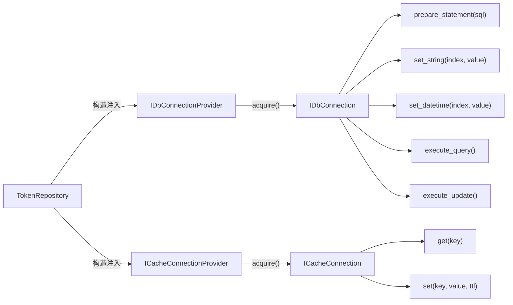
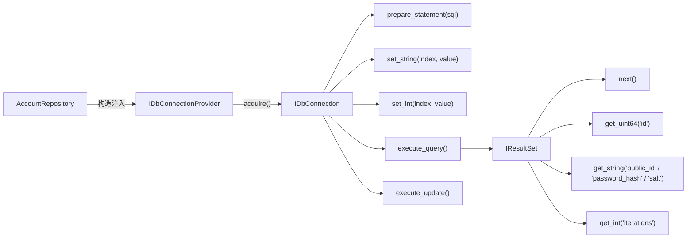
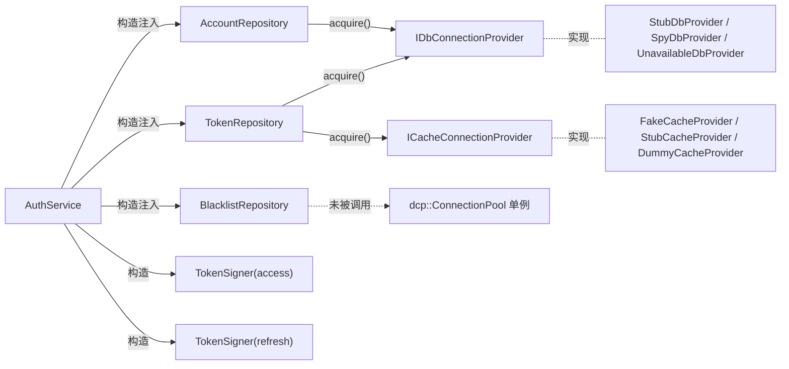

# SDU-Forum 后端单元测试设计手册

> 本文档用于记录**所有单元**的测试替身设计与用例设计，是活文档，不是审查报告。
>
> 当前收录：
>
> - `repository::AccountRepository`
> - `repository::TokenRepository`
> - `service::AuthService`
> - `utils::timestamp_to_string`
>
> 后续新增模块时，在对应位置追加模块章节，并更新第 1 节的模块索引。

## 1. 模块索引

| 模块 | 测试可执行文件 | CTest 名称 | 用例数 | 使用替身 |
|---|---|---|---:|---|
| `repository::AccountRepository` | `test_account_repository` | `AccountRepositoryUnit` | 21 | Stub / Spy / Unavailable |
| `repository::AdminAccountRepository` | `test_admin_account_repository` | `AdminAccountRepositoryUnit` | 15 | Stub / Spy / Unavailable |
| `repository::TokenRepository` | `test_token_repository` | `TokenRepositoryUnit` | 34 | Dummy / Stub / Spy / Mock / Fake / Unavailable |
| `service::AuthService` | `test_auth_service` | `AuthServiceUnit` | 34 | Dummy / Stub / Spy / Fake / Unavailable |
| `utils::timestamp_to_string` | `test_utils` | `UtilsUnit` | 1 | 无（纯函数） |

- 测试框架：doctest 2.4.11
- 构建系统：CMake + CTest
- 单元测试标签：`fast;unit`
- 默认超时：10 秒（`AuthServiceUnit` 因 PBKDF2 默认轮次取 60 秒）
- 单元测试不得访问 MySQL、Redis、网络

## 2. 测试框架约定

### 2.1 目录结构

```text
backend/tests/
├── CMakeLists.txt
├── third_party/
│   └── doctest.h
├── support/
│   ├── test_main.cpp
│   └── test_doubles.h
├── unit/
│   ├── repositories/
│   │   ├── test_account_repository.cpp
│   │   └── test_token_repository.cpp
│   ├── services/
│   │   └── test_auth_service.cpp
│   └── utils/
│       └── test_utils.cpp
└── docs/
    └── tests.md
```

### 2.2 命名与结构约定

- 测试文件：`unit/<层>/test_<单元>.cpp`
- 测试套件：`TEST_SUITE("<单元名>")`
- 用例名：`<方法> <行为> <场景>`，例如 `find_xxx returns false on cache miss`
- 用例结构：Arrange → Act → Assert；Mock 用例追加 Verify
- 异常断言：断言 `common::ErrorCode`，不断言错误文案
- 一个用例只保留一个失败理由；需要同时验证返回值和交互时，拆成两个用例

### 2.3 五类替身的使用边界

| 替身 | 用途 | 断言对象 | 本项目中的实现 |
|---|---|---|---|
| Dummy | 占满构造参数，不被访问 | 无 | `DummyDbProvider`、`DummyCacheProvider` |
| Stub | 提供固定返回值或固定异常 | 被测对象的返回值/状态 | `StubDbConnection`、`StubCacheConnection`、`Unavailable*Provider` |
| Spy | 记录调用参数与顺序 | 交互是否发生、顺序 | `SpyDbConnection` |
| Mock | 预置期望并统一校验 | 交互契约本身 | `MockCacheConnection` |
| Fake | 真实但轻量的实现 | 端到端状态 | `FakeCacheConnection` |

## 3. 全局测试替身清单

所有替身定义在 [test_doubles.h](../support/test_doubles.h)。

### 3.1 替身总表

| 替身 | 实现接口 | 角色 | 核心能力 |
|---|---|---|---|
| `StubResultSet` | `dcp::IResultSet` | Stub | 控制 `next()` 行数；可按列名返回预设的值或默认值 |
| `StubDbConnection` | `repository::IDbConnection` | Stub | 固定查询行数、更新行数、异常开关、空结果集 |
| `SpyDbConnection` | `repository::IDbConnection` | Spy | 记录 SQL、绑定参数、调用次数与事件顺序 |
| `StubCacheConnection` | `repository::ICacheConnection` | Stub | 固定 `set` 返回值、`get/set` 异常开关 |
| `FakeCacheConnection` | `repository::ICacheConnection` | Fake | 内存键值存储 + TTL 记录 |
| `MockCacheConnection` | `repository::ICacheConnection` | Mock | 预置 `set` 期望，记录 `get/set` 调用与顺序，`verify()` 校验 |
| `DummyDbProvider` | `repository::IDbConnectionProvider` | Dummy | 返回 `nullptr`，表示“不应被访问” |
| `DummyCacheProvider` | `repository::ICacheConnectionProvider` | Dummy | 返回 `nullptr`，表示“不应被访问” |
| `UnavailableDbProvider` | `repository::IDbConnectionProvider` | Stub | 返回 `nullptr`，表示“被访问但连接不可用” |
| `UnavailableCacheProvider` | `repository::ICacheConnectionProvider` | Stub | 返回 `nullptr`，表示“被访问但连接不可用” |
| `StubDbProvider` | `repository::IDbConnectionProvider` | Stub Provider | 原型 + 共享 State |
| `SpyDbProvider` | `repository::IDbConnectionProvider` | Spy Provider | 原型 + 共享 State |
| `StubCacheProvider` | `repository::ICacheConnectionProvider` | Stub Provider | 原型 + 共享 State |
| `FakeCacheProvider` | `repository::ICacheConnectionProvider` | Fake Provider | 原型 + 共享 State |
| `MockCacheProvider` | `repository::ICacheConnectionProvider` | Mock Provider | 原型 + 共享 State |

### 3.2 `StubResultSet`

`StubRowValues` 是结果集的行值配置：

| 字段 | 类型 | 默认值 | 作用 |
|---|---|---|---|
| `uint64_columns` | `unordered_map<string,uint64_t>` | 空 | 按列名返回的无符号整型值 |
| `int_columns` | `unordered_map<string,int>` | 空 | 按列名返回的整型值 |
| `string_columns` | `unordered_map<string,string>` | 空 | 按列名返回的字符串值 |

| 成员 | 类型 | 默认值 | 作用 |
|---|---|---|---|
| `m_row_count` | `int` | 构造参数，默认 0 | `next()` 返回 true 的行数 |
| `m_seen` | `int` | 0 | 已读取行数 |
| `m_values` | `shared_ptr<const StubRowValues>` | `nullptr` | 按列名返回的行值 |

行为：

- `next()`：`m_seen < m_row_count` 时返回 true，并递增 `m_seen`
- `close()`：空实现
- `get_string/get_int/get_uint64(name)`：`m_values` 命中列名时返回预设值，否则返回 0 或空字符串
- 其余 `get_*`、`is_null`、按索引读取：返回 0、空字符串、false
- TokenRepository 只用它做“是否存在一行”的判断；AccountRepository 用它断言整行字段映射

### 3.3 数据库替身

#### `StubDbState`

| 字段 | 类型 | 默认值 | 作用 |
|---|---|---|---|
| `has_row` | `bool` | `false` | `execute_query()` 返回 0 行或 1 行 |
| `update_rows` | `int` | `1` | `execute_update()` 返回的受影响行数 |
| `throw_on_query` | `bool` | `false` | `execute_query()` 抛 `sql::SQLException` |
| `throw_on_update` | `bool` | `false` | `execute_update()` 抛 `sql::SQLException` |
| `return_null_result_set` | `bool` | `false` | `execute_query()` 返回 `nullptr` |
| `throw_on_prepare` | `bool` | `false` | `prepare_statement()` 抛 `sql::SQLException` |
| `throw_on_set_string` | `bool` | `false` | `set_string()` 抛 `sql::SQLException` |
| `throw_on_set_int` | `bool` | `false` | `set_int()` 抛 `sql::SQLException` |
| `throw_on_set_datetime` | `bool` | `false` | `set_datetime()` 抛 `sql::SQLException` |
| `row` | `shared_ptr<StubRowValues>` | 非空 | 查询返回行的列值，传递给 `StubResultSet` |

#### `StubDbConnection`

- `prepare_statement`：`throw_on_prepare` 为 true 时抛异常
- `set_string`：`throw_on_set_string` 为 true 时抛异常
- `set_int`：`throw_on_set_int` 为 true 时抛异常
- `set_datetime`：`throw_on_set_datetime` 为 true 时抛异常
- `execute_query`：按 `throw_on_query`、`return_null_result_set`、`has_row` 依次处理，返回的 `StubResultSet` 共享 `row` 行值
- `execute_update`：按 `throw_on_update`、`update_rows` 处理
- 不记录 SQL 和绑定参数；需要交互断言时使用 `SpyDbConnection`

#### `SpyDbState`

| 字段 | 类型 | 默认值 | 作用 |
|---|---|---|---|
| `has_row` | `bool` | `false` | 查询返回 1 行或 0 行 |
| `update_rows` | `int` | `1` | 更新返回的受影响行数 |
| `prepared_sql` | `std::string` | 空 | 最近一次预处理的 SQL |
| `string_params` | `vector<pair<uint16_t,string>>` | 空 | 字符串绑定参数，保留下标与顺序 |
| `int_params` | `vector<pair<uint16_t,int>>` | 空 | 整型绑定参数，保留下标与顺序 |
| `datetime_params` | `vector<pair<uint16_t,string>>` | 空 | 时间绑定参数，保留下标与顺序 |
| `prepare_calls` | `int` | 0 | 预处理次数 |
| `query_calls` | `int` | 0 | 查询次数 |
| `update_calls` | `int` | 0 | 更新次数 |
| `events` | `vector<string>` | 空 | 调用顺序：`prepare`、`bind_string`、`bind_int`、`bind_datetime`、`query`、`update` |
| `row` | `shared_ptr<StubRowValues>` | 非空 | 查询返回行的列值，传递给 `StubResultSet` |

#### `SpyDbConnection`

- 每个方法先写入 `events`，再记录对应参数或次数
- `execute_query()` 返回的 `StubResultSet` 共享 `row` 行值，但**不支持空结果集和查询异常**；这些场景使用 `StubDbConnection`
- `string_params`、`int_params`、`datetime_params` 使用 `vector<pair>`，用于断言绑定下标和顺序

### 3.4 缓存替身

#### `FakeCacheState`

| 字段 | 类型 | 默认值 | 作用 |
|---|---|---|---|
| `store` | `unordered_map<string,string>` | 空 | 缓存键值 |
| `ttls` | `unordered_map<string,int>` | 空 | 每个键的 TTL |

#### `FakeCacheConnection`

- `get(key)`：存在返回对应值，不存在返回 `nullopt`
- `set(key, value, ttl)`：写入 `store` 和 `ttls`，固定返回 true
- `put(key, value, ttl)`：测试预置数据
- `contains(key)`：判断键是否存在
- `ttl_of(key)`：返回 TTL，不存在返回 -1
- 不能模拟写入失败；写入失败场景使用 `StubCacheConnection`

#### `StubCacheState`

| 字段 | 类型 | 默认值 | 作用 |
|---|---|---|---|
| `throw_on_get` | `bool` | `false` | `get()` 抛 `std::runtime_error` |
| `throw_on_set` | `bool` | `false` | `set()` 抛 `std::runtime_error` |
| `set_result` | `bool` | `true` | `set()` 的固定返回值 |

#### `StubCacheConnection`

- `get()`：`throw_on_get` 为 true 时抛异常，否则返回 `nullopt`
- `set()`：`throw_on_set` 为 true 时抛异常，否则返回 `set_result`
- 不保存数据；需要“写入后可读”时使用 `FakeCacheConnection`

#### `MockCacheState`

| 字段 | 类型 | 默认值 | 作用 |
|---|---|---|---|
| `expected_get_calls` | `int` | 1 | 期望的 `get` 次数 |
| `expected_sets` | `vector<ExpectedSet>` | 空 | 期望的 `set` 序列 |
| `set_calls` | `vector<SetCall>` | 空 | 实际 `set` 序列 |
| `get_calls` | `int` | 0 | 实际 `get` 次数 |
| `get_result` | `optional<string>` | `nullopt` | `get` 返回的缓存值 |
| `set_result` | `bool` | `true` | `set` 返回结果 |
| `throw_on_get` | `bool` | `false` | `get` 是否抛异常 |
| `throw_on_set` | `bool` | `false` | `set` 是否抛异常 |
| `last_get_key` | `string` | 空 | 最近一次读取的 key |
| `events` | `vector<string>` | 空 | 调用顺序：`get`、`set` |

#### `MockCacheConnection`

`SetCall` 与 `ExpectedSet` 均包含 `key`、`value`、`ttl_seconds` 三个字段。

- `expect_set(key, value, ttl)`：追加一条写入期望
- `get(key)`：记录 `last_get_key`、`events`、`get_calls`，按需抛异常，返回 `get_result`
- `set(key, value, ttl)`：记录 `events`、`set_calls`，按需抛异常，返回 `set_result`
- `verify()`：
  - 断言 `get_calls == expected_get_calls`
  - 断言 `set_calls` 与 `expected_sets` 数量一致
  - 逐条断言 key、value、ttl 一致

### 3.5 Provider 约定

所有 Provider 都采用“原型 + 共享 State”模式：

```cpp
class XxxProvider final : public IXxxProvider
{
public:
    XxxConnection& connection();  // 或 fake() / mock()
    std::unique_ptr<IXxx> acquire() override;
private:
    XxxConnection m_prototype;
};
```

- `acquire()` 返回新的连接句柄
- 新句柄与原型共享 `shared_ptr<State>`
- 测试通过 `connection()`、`fake()`、`mock()` 读写 State
- `Dummy*` 与 `Unavailable*` 没有 State，`acquire()` 直接返回 `nullptr`

### 3.6 替身与用例引用矩阵（TokenRepository）

| 替身 | 被哪些用例使用 |
|---|---|
| `DummyDbProvider` | 1, 2, 3, 4, 5, 6, 7, 12, 21, 22, 27, 28, 29, 30, 31 |
| `DummyCacheProvider` | 1, 8, 9, 10, 11, 25, 26, 32 |
| `UnavailableDbProvider` | 10, 17 |
| `UnavailableCacheProvider` | 4, 7, 16, 33 |
| `StubDbConnection` / `StubDbProvider` | 9, 11, 13, 14, 18, 19, 23, 24, 25, 26, 33, 34 |
| `SpyDbConnection` / `SpyDbProvider` | 8, 15, 16, 20, 32 |
| `FakeCacheConnection` / `FakeCacheProvider` | 2, 3, 5, 12, 15, 17, 18, 19, 27, 28, 29 |
| `StubCacheConnection` / `StubCacheProvider` | 6, 21, 22, 23, 34 |
| `MockCacheConnection` / `MockCacheProvider` | 13, 14, 20, 24, 30, 31 |
| `StubResultSet` | 由 `StubDbConnection`、`SpyDbConnection` 内部使用 |

### 3.7 替身与用例引用矩阵（AccountRepository）

| 替身 | 被哪些用例使用 |
|---|---|
| `StubDbConnection` / `StubDbProvider` | 1, 2, 5, 6, 7, 8, 9, 10, 13, 14, 15, 16, 17, 18, 21 |
| `SpyDbConnection` / `SpyDbProvider` | 3, 11, 19 |
| `UnavailableDbProvider` | 4, 12, 20 |
| `StubResultSet` / `StubRowValues` | 1（由 `StubDbConnection` 内部使用并携带整行字段值） |
| `Dummy*` / `Mock*` / `Fake*` / `*CacheProvider` | 不使用：AccountRepository 没有缓存依赖 |

### 3.8 替身与用例引用矩阵（AuthService）

| 替身 | 被哪些用例使用 |
|---|---|
| `StubDbConnection` / `StubDbProvider` | 1, 2, 3, 4, 5, 6, 8, 10, 12, 13, 14, 15, 16, 17, 19, 20, 23, 24, 27, 29, 30, 32, 33 |
| `SpyDbConnection` / `SpyDbProvider` | 9, 11, 18, 22, 25, 26, 31 |
| `UnavailableDbProvider` | 7, 14, 21, 28, 34 |
| `DummyCacheProvider` | 10, 11, 12, 13, 14, 15 |
| `FakeCacheConnection` / `FakeCacheProvider` | 1, 2, 3, 4, 5, 6, 7, 8, 9, 16, 17, 18, 19, 21, 22, 23, 24, 25, 26, 28, 29, 30, 31, 32, 34 |
| `StubCacheConnection` / `StubCacheProvider` | 20, 27, 33 |
| `StubResultSet` / `StubRowValues` | 1–9（登录成功路径由 `Stub/Spy` 携带账号行值）；`SpyDbState::row` 即为此新增 |
| `MockCacheConnection` / `MockCacheProvider` | 不使用：AuthService 对缓存只做写入/降级判断，无回写契约需要校验 |

## 4. TokenRepository

### 4.1 被测单元与依赖

被测文件：

- [token_repository.h](../../repositories/token_repository.h)
- [token_repository.cpp](../../repositories/token_repository.cpp)

依赖接口：

- [connection_provider.h](../../repositories/connection_provider.h)



| 依赖接口 | 方法 | 返回/副作用 | 调用点 |
|---|---|---|---|
| `IDbConnection` | `prepare_statement` | 无 | `insert_refresh_token`、`find_refresh_token` |
| `IDbConnection` | `set_string` | 无 | `insert_refresh_token`、`find_refresh_token` |
| `IDbConnection` | `set_datetime` | 无 | `insert_refresh_token` |
| `IDbConnection` | `execute_query` | 返回 `IResultSet` | `find_refresh_token` |
| `IDbConnection` | `execute_update` | 返回受影响行数 | `insert_refresh_token` |
| `ICacheConnection` | `get` | 返回 `optional<string>` | `find_access_token`、`find_refresh_token` |
| `ICacheConnection` | `set` | 返回 bool | `insert_access_token`、`find_refresh_token` |

### 4.2 行为覆盖矩阵

| 方法 | 正常 | 边界 | 异常 | 交互 |
|---|---|---|---|---|
| `hash_secret` | 返回配置值 | 不测：配置由上层保证 | 不测：返回 const 引用，无异常路径 | 不适用 |
| `find_access_token` | 缓存命中 → true | 未命中 → false；空字符串值 → true | 连接不可用、`get` 抛异常 → 返回 false | 只读，不写缓存 |
| `insert_access_token` | 写入成功 → true | 写入被拒 → false；TTL=0 原样转发 | 连接不可用、`set` 抛异常 → 返回 false | key/value 均为 token_hash；TTL 转发 |
| `insert_refresh_token` | 插入 1 行 → true | 0 行 → false | 连接不可用、prepare/bind/update 异常 → DatabaseError | INSERT SQL、绑定下标、事件顺序 |
| `find_refresh_token` | 缓存命中 → true；DB 命中 → true + 回写 | DB 无行 → false；回写失败/回写抛异常仍 true | 缓存不可用/`get` 异常 → 降级 DB；SQL/空结果集 → DatabaseError | SELECT SQL、绑定、回写契约、负向交互 |

### 4.3 用例目录

> 编号是本文档的设计编号，与 [test_token_repository.cpp](../unit/repositories/test_token_repository.cpp) 中的 `TEST_CASE` 一一对应；下表按方法分组展示，不要求与文件行序一致。

#### 配置读取

| # | 用例名 | 替身配置 | 断言 |
|---|---|---|---|
| 1 | `hash_secret returns configured secret` | DummyDb + DummyCache | 返回 `"unit-test-secret"` |

#### access_token 缓存读写

| # | 用例名 | 替身配置 | 断言 |
|---|---|---|---|
| 2 | `find_access_token returns true on cache hit` | DummyDb + FakeCache，预置 key | 返回 true |
| 3 | `find_access_token returns false on cache miss` | DummyDb + FakeCache，空 | 返回 false |
| 4 | `find_access_token returns false when cache unavailable` | DummyDb + UnavailableCache | 返回 false |
| 21 | `find_access_token returns false when cache get throws` | DummyDb + StubCache，`throw_on_get=true` | 返回 false |
| 28 | `find_access_token returns true for empty-string value` | DummyDb + FakeCache，值为空字符串 | 返回 true |
| 31 | `find_access_token does not write cache` | DummyDb + MockCache，空期望 | 返回 false；`set_calls` 为空；`last_get_key` 正确；事件仅 `get`；`verify()` |

#### access_token 写入

| # | 用例名 | 替身配置 | 断言 |
|---|---|---|---|
| 5 | `insert_access_token stores token with configured ttl` | DummyDb + FakeCache | 返回 true；key 存在；TTL=600 |
| 6 | `insert_access_token returns false when cache rejects write` | DummyDb + StubCache，`set_result=false` | 返回 false |
| 7 | `insert_access_token returns false when cache unavailable` | DummyDb + UnavailableCache | 返回 false |
| 22 | `insert_access_token returns false when cache set throws` | DummyDb + StubCache，`throw_on_set=true` | 返回 false |
| 27 | `insert_access_token stores the exact token value` | DummyDb + FakeCache | 缓存 value 等于 token_hash |
| 29 | `insert_access_token forwards zero ttl` | DummyDb + FakeCache，`access_ttl_s=0` | 返回 true；TTL=0 |

#### refresh_token 数据库写入

| # | 用例名 | 替身配置 | 断言 |
|---|---|---|---|
| 8 | `insert_refresh_token binds hash and expiry datetime` | SpyDb，`update_rows=1` + DummyCache | 返回 true；INSERT SQL 正确；字符串参数下标 1；时间参数下标 2；时间字符串正确；`update_calls=1`；事件序列正确 |
| 9 | `insert_refresh_token returns false when no row inserted` | StubDb，`update_rows=0` + DummyCache | 返回 false |
| 10 | `insert_refresh_token throws DatabaseError when db unavailable` | UnavailableDb + DummyCache | 抛 DatabaseError |
| 11 | `insert_refresh_token throws DatabaseError on sql failure` | StubDb，`throw_on_update=true` + DummyCache | 抛 DatabaseError |
| 25 | `insert_refresh_token throws DatabaseError when prepare fails` | StubDb，`throw_on_prepare=true` + DummyCache | 抛 DatabaseError |
| 26 | `insert_refresh_token throws DatabaseError when binding fails` | StubDb，`throw_on_set_string=true` + DummyCache | 抛 DatabaseError |
| 32 | `insert_refresh_token does not execute query` | SpyDb，`update_rows=1` + DummyCache | 返回 true；`query_calls=0`；事件序列不含 `query` |

#### refresh_token 查询与缓存回写

| # | 用例名 | 替身配置 | 断言 |
|---|---|---|---|
| 12 | `find_refresh_token returns true on cache hit without db access` | DummyDb + FakeCache，预置 key | 返回 true |
| 13 | `find_refresh_token loads from db and writes back to cache` | StubDb，`has_row=true` + MockCache，`expect_set` | 返回 true；`verify()`；事件 `get → set` |
| 14 | `find_refresh_token returns false and skips cache on db miss` | StubDb，`has_row=false` + MockCache，空期望 | 返回 false；`verify()` |
| 15 | `find_refresh_token queries table and binds token hash` | SpyDb，`has_row=true` + FakeCache，空 | 返回 true；SELECT SQL 正确；绑定下标 1；`query_calls=1`；事件 `prepare → bind_string → query` |
| 16 | `find_refresh_token falls back to db when cache unavailable` | SpyDb，`has_row=true` + UnavailableCache | 返回 true；`prepare_calls=1`；`query_calls=1`；SELECT SQL 正确 |
| 17 | `find_refresh_token throws DatabaseError when db unavailable` | UnavailableDb + FakeCache，空 | 抛 DatabaseError |
| 18 | `find_refresh_token throws DatabaseError on sql failure` | StubDb，`throw_on_query=true` + FakeCache | 抛 DatabaseError |
| 19 | `find_refresh_token throws DatabaseError when query result is null` | StubDb，`return_null_result_set=true` + FakeCache | 抛 DatabaseError |
| 20 | `find_refresh_token falls back to db when cache get throws` | SpyDb，`has_row=true` + MockCache，`throw_on_get=true`，`expect_set` | 返回 true；`prepare_calls=1`；`query_calls=1`；`verify()`；事件 `get → set` |
| 23 | `find_refresh_token returns true when cache write-back throws` | StubDb，`has_row=true` + StubCache，`throw_on_set=true` | 返回 true |
| 24 | `find_refresh_token returns true when cache write-back fails` | StubDb，`has_row=true` + MockCache，`set_result=false` | 返回 true；`verify()` |
| 30 | `find_refresh_token does not write cache on cache hit` | DummyDb + MockCache，`get_result=hash` | 返回 true；`set_calls` 为空；`last_get_key` 正确；事件仅 `get`；`verify()` |
| 33 | `find_refresh_token returns false from db fallback when cache unavailable` | StubDb，`has_row=false` + UnavailableCache | 返回 false |
| 34 | `find_refresh_token returns false from db fallback when cache get throws` | StubDb，`has_row=false` + StubCache，`throw_on_get=true` | 返回 false |

### 4.4 交互契约

#### `insert_refresh_token`

- SQL：`INSERT INTO refresh_token_it (token_hash,expires_at) VALUES (?,?)`
- 字符串参数：下标 1，值 `token_hash`
- 时间参数：下标 2，值 `utils::timestamp_to_string(exp_at)`
- 事件顺序：`prepare → bind_string → bind_datetime → update`
- 返回：`execute_update()` 的行数大于 0 时为 true

#### `find_refresh_token`

- SQL：`SELECT id FROM refresh_token_it WHERE token_hash=?`
- 字符串参数：下标 1，值 `token_hash`
- 事件顺序：`prepare → bind_string → query`
- 缓存不可用：直接降级到 DB；DB 有行 true，无行 false；不写缓存
- 缓存命中：直接返回 true，不访问 DB，不写缓存
- 缓存未命中且 DB 有行：写回缓存，key/value 均为 `token_hash`，TTL 为 `refresh_ttl_s`
- 缓存未命中且 DB 无行：返回 false，不写缓存
- 缓存 `get` 抛异常：捕获并记录日志，按缓存未命中处理，降级到 DB；DB 有行 true（并尝试回写），无行 false
- 缓存回写语义：
  - `set` 返回 false：best-effort，仍返回 true
  - `set` 抛异常：捕获并记录日志，仍返回 true

#### `insert_access_token`

- 缓存 key：`token_hash`
- 缓存 value：`token_hash`
- TTL：`access_ttl_s`
- 返回：`set` 的返回值
- 缓存不可用或 `set` 抛异常：返回 false

#### `find_access_token`

- 缓存 key：`token_hash`
- 返回：`get` 是否有值，空字符串也算命中
- 缓存不可用或 `get` 抛异常：返回 false

### 4.5 错误映射

| 场景 | 错误码/结果 |
|---|---|
| DB 连接不可用 | `common::ErrorCode::DatabaseError` |
| `prepare_statement` / `set_string` / `set_datetime` / `execute_query` / `execute_update` 抛 `sql::SQLException` | `common::ErrorCode::DatabaseError` |
| `execute_query()` 返回 `nullptr` | `common::ErrorCode::DatabaseError` |
| `find_refresh_token` 缓存连接不可用 | 降级 DB，不抛 RedisError |
| `find_access_token` / `insert_access_token` 缓存连接不可用 | 返回 false |
| `find_refresh_token` 缓存 `get` 抛 `std::exception` | 捕获并记录日志，降级 DB（有行 true、无行 false），不抛 RedisError |
| `find_access_token` 缓存 `get` 抛 `std::exception` | 返回 false |
| `find_refresh_token` 缓存 `set` 抛 `std::exception` | 捕获并记录日志，返回 true |
| `insert_access_token` 缓存 `set` 抛 `std::exception` | 返回 false |
| `find_refresh_token` 缓存 `set` 返回 false | 返回 true（best-effort） |
| `insert_access_token` 缓存 `set` 返回 false | 返回 false |

### 4.6 测试配置与辅助函数

`make_config()` 返回：

| 字段 | 值 |
|---|---|
| `refresh_token_table` | `refresh_token_it` |
| `hash_secret` | `unit-test-secret` |
| `refresh_ttl_s` | 3600 |
| `access_ttl_s` | 600 |

`throws_with_code(callable, expected)`：

- 捕获 `common::AppException` 并比较 `code()`
- 捕获其他异常或未抛异常时返回 false

### 4.7 测试文件与 CMake

| 项 | 值 |
|---|---|
| 源文件 | `unit/repositories/test_token_repository.cpp` |
| 公共 main | `support/test_main.cpp` |
| 链接库 | `sdu_app` |
| 可执行文件 | `test_token_repository` |
| CTest 名称 | `TokenRepositoryUnit` |
| 标签 | `fast;unit` |
| 超时 | 10 秒 |

## 5. AccountRepository

### 5.1 被测单元与依赖

被测文件：

- [account_repository.h](../../repositories/account_repository.h)
- [account_repository.cpp](../../repositories/account_repository.cpp)

依赖接口：

- [connection_provider.h](../../repositories/connection_provider.h)

构造注入：`IDbConnectionProvider&` + 账号表名。本模块**只依赖数据库**，不持有缓存提供者。



| 依赖接口 | 方法 | 返回/副作用 | 调用点 |
|---|---|---|---|
| `IDbConnectionProvider` | `acquire` | 返回连接；无可用连接时为 `nullptr` | 三个方法入口 |
| `IDbConnection` | `prepare_statement` | 无 | `find_account_by_user_id`、`insert_account_by_user_id`、`delete_account_by_public_id` |
| `IDbConnection` | `set_string` | 无 | `find_account_by_user_id`（1 个）、`insert_account_by_user_id`（4 个）、`delete_account_by_public_id`（1 个） |
| `IDbConnection` | `set_int` | 无 | `insert_account_by_user_id`（下标 5：iterations） |
| `IDbConnection` | `execute_query` | 返回 `IResultSet`；可能为 `nullptr` | `find_account_by_user_id` |
| `IDbConnection` | `execute_update` | 返回受影响行数 | `insert_account_by_user_id`、`delete_account_by_public_id` |
| `IResultSet` | `next` | 是否存在下一行 | `find_account_by_user_id` |
| `IResultSet` | `get_uint64` / `get_string` / `get_int` | 按列名读取字段值 | `find_account_by_user_id` |

`set_datetime` 与结果集的 `close()`、列数、按索引读取方法在本模块中**不被调用**。

### 5.2 行为覆盖矩阵

| 方法 | 正常 | 边界 | 异常 | 交互 |
|---|---|---|---|---|
| `find_account_by_user_id` | 查到一行 → 返回完整 record | 无行 → `nullopt` | 连接不可用、prepare/bind/query 异常、结果集为 `nullptr` → DatabaseError | SELECT 列清单、绑定 user_id、1 次 query、不调用 update |
| `insert_account_by_user_id` | 插入 1 行 → true | 0 行 → false | 连接不可用、prepare/set_string/set_int/update 异常 → DatabaseError | INSERT 五参数下标与顺序、不调用 query |
| `delete_account_by_public_id` | 删除 1 行 → true | 0 行 → false | 连接不可用、prepare/bind/update 异常 → DatabaseError | DELETE 语句、绑定 public_id |
| 输入校验（空 user_id / 空 public_id） | — | 不测：校验在 `AuthService`，仓库只透传 | — | — |
| 连接归还 | — | 不测：由 `PooledDbConnectionProvider` 的 RAII 守卫负责 | — | — |
| 缓存读写 | — | 不测：本模块无缓存依赖 | — | — |

### 5.3 用例目录

> 编号是本文档的设计编号，与 [test_account_repository.cpp](../unit/repositories/test_account_repository.cpp) 中的 `TEST_CASE` 一一对应；下表按方法分组展示。

#### 账号查询

| # | 用例名 | 替身配置 | 断言 |
|---|---|---|---|
| 1 | `find_account_by_user_id returns record when row exists` | StubDb，`has_row=true`，`row` 预置 id/public_id/hash/salt/iterations | 返回 record，五个字段与预置行一致 |
| 2 | `find_account_by_user_id returns nullopt when no row` | StubDb，`has_row=false` | 返回 `nullopt` |
| 3 | `find_account_by_user_id binds user id and selects credential columns` | SpyDb，`has_row=true` | SELECT SQL 正确；字符串参数下标 1、值 `alice`；无整型参数；`query_calls=1`；`update_calls=0`；事件 `prepare → bind_string → query` |
| 4 | `find_account_by_user_id throws DatabaseError when db unavailable` | UnavailableDb | 抛 DatabaseError |
| 5 | `find_account_by_user_id throws DatabaseError on sql failure` | StubDb，`throw_on_query=true` | 抛 DatabaseError |
| 6 | `find_account_by_user_id throws DatabaseError when prepare fails` | StubDb，`throw_on_prepare=true` | 抛 DatabaseError |
| 7 | `find_account_by_user_id throws DatabaseError when binding fails` | StubDb，`throw_on_set_string=true` | 抛 DatabaseError |
| 8 | `find_account_by_user_id throws DatabaseError when query result is null` | StubDb，`return_null_result_set=true` | 抛 DatabaseError |

#### 账号写入

| # | 用例名 | 替身配置 | 断言 |
|---|---|---|---|
| 9 | `insert_account_by_user_id returns true when row inserted` | StubDb，`update_rows=1` | 返回 true |
| 10 | `insert_account_by_user_id returns false when no row inserted` | StubDb，`update_rows=0` | 返回 false |
| 11 | `insert_account_by_user_id binds public id user id hash salt iterations` | SpyDb，`update_rows=1` | INSERT SQL 正确；字符串参数 4 条（下标 1–4：public_id/user_id/hash/salt）；整型参数 1 条（下标 5：iterations）；`query_calls=0`；`update_calls=1`；事件 `prepare → bind_string×4 → bind_int → update` |
| 12 | `insert_account_by_user_id throws DatabaseError when db unavailable` | UnavailableDb | 抛 DatabaseError |
| 13 | `insert_account_by_user_id throws DatabaseError on sql failure` | StubDb，`throw_on_update=true` | 抛 DatabaseError |
| 14 | `insert_account_by_user_id throws DatabaseError when prepare fails` | StubDb，`throw_on_prepare=true` | 抛 DatabaseError |
| 15 | `insert_account_by_user_id throws DatabaseError when string binding fails` | StubDb，`throw_on_set_string=true` | 抛 DatabaseError |
| 16 | `insert_account_by_user_id throws DatabaseError when iteration binding fails` | StubDb，`throw_on_set_int=true` | 抛 DatabaseError |

#### 账号删除

| # | 用例名 | 替身配置 | 断言 |
|---|---|---|---|
| 17 | `delete_account_by_public_id returns true when row deleted` | StubDb，`update_rows=1` | 返回 true |
| 18 | `delete_account_by_public_id returns false when no row deleted` | StubDb，`update_rows=0` | 返回 false |
| 19 | `delete_account_by_public_id binds public id and targets account table` | SpyDb，`update_rows=1` | DELETE SQL 正确；字符串参数下标 1、值 `usr_alice`；`query_calls=0`；`update_calls=1`；事件 `prepare → bind_string → update` |
| 20 | `delete_account_by_public_id throws DatabaseError when db unavailable` | UnavailableDb | 抛 DatabaseError |
| 21 | `delete_account_by_public_id throws DatabaseError on sql failure` | StubDb，`throw_on_update=true` | 抛 DatabaseError |

### 5.4 交互契约

#### `find_account_by_user_id`

- SQL：`SELECT id, public_id, password_hash, salt, iterations FROM account_it WHERE user_id = ?`
- 字符串参数：下标 1，值 `user_id`
- 事件顺序：`prepare → bind_string → query`
- 结果集为空或 `next()` 返回 false：返回 `nullopt`
- 命中一行：`id` 用 `get_uint64`，`public_id`/`password_hash`/`salt` 用 `get_string`，`iterations` 用 `get_int`

#### `insert_account_by_user_id`

- SQL：`INSERT INTO account_it (public_id,user_id,password_hash,salt,iterations) VALUES(?,?,?,?,?)`
- 字符串参数：下标 1 `public_id`、下标 2 `user_id`、下标 3 `password_hash`、下标 4 `salt`
- 整型参数：下标 5 `iterations`
- 事件顺序：`prepare → bind_string ×4 → bind_int → update`
- 返回：`execute_update()` 行数为 0 时 false，其余为 true
- 查重不在此处进行，由业务层负责

#### `delete_account_by_public_id`

- SQL：`DELETE FROM account_it WHERE public_id=?`
- 字符串参数：下标 1，值 `public_id`
- 事件顺序：`prepare → bind_string → update`
- 返回：受影响行数大于 0 时为 true

### 5.5 错误映射

| 场景 | 错误码/结果 |
|---|---|
| `acquire()` 返回 `nullptr` | `common::ErrorCode::DatabaseError` |
| `prepare_statement` / `set_string` / `set_int` / `execute_update` 抛 `sql::SQLException` | `common::ErrorCode::DatabaseError` |
| `execute_query()` 抛 `sql::SQLException` | `common::ErrorCode::DatabaseError` |
| `execute_query()` 返回 `nullptr` | `common::ErrorCode::DatabaseError` |
| 查询无行 | 返回 `std::nullopt`，不抛异常 |
| 插入/删除 0 行 | 返回 false，不抛异常 |

### 5.6 测试配置与辅助函数

`kAccountTable`：`account_it`

`make_account()` 返回：

| 字段 | 值 |
|---|---|
| `id` | 0（插入流程不读取） |
| `public_id` | `usr_alice` |
| `password_hash` | `hash-value` |
| `salt` | `salt-value` |
| `iterations` | 120000 |

`throws_with_code(callable, expected)`：与 TokenRepository 共用同一实现，捕获 `common::AppException` 并比较 `code()`。

### 5.7 测试文件与 CMake

| 项 | 值 |
|---|---|
| 源文件 | `unit/repositories/test_account_repository.cpp` |
| 公共 main | `support/test_main.cpp` |
| 链接库 | `sdu_app` |
| 可执行文件 | `test_account_repository` |
| CTest 名称 | `AccountRepositoryUnit` |
| 标签 | `fast;unit` |
| 超时 | 10 秒 |

### 5.8 接缝说明

AccountRepository 原先直接持有 `dcp::ConnectionPool&`，无法注入替身。落地本模块测试时按“接缝优先”原则做了最小改造：

- `IDbConnection` 增加 `set_int`，`PooledDbConnection` 转发到 `IDatabaseConnection::set_int`
- `AccountRepository` 构造参数改为 `IDbConnectionProvider&`，与 `TokenRepository` 保持一致
- `AuthModule` 调整成员声明顺序，先构造 provider 再构造仓库

## 6. Utils

### 6.1 被测单元

- 源文件：[utils.cpp](../../utils/utils.cpp)
- 头文件：[utils.h](../../utils/utils.h)
- 被测函数：`utils::timestamp_to_string(uint64_t)`

该函数是纯函数，无外部依赖，不使用任何测试替身。

### 6.2 用例目录

| # | 用例名 | 输入 | 断言 |
|---|---|---|---|
| 1 | `timestamp_to_string formats epoch deterministically` | `0` | `"1970-01-01 00:00:00"` |
| | | `1700000000` | `"2023-11-14 22:13:20"` |
| | | `2147483647` | `"2038-01-19 03:14:07"` |

### 6.3 测试文件与 CMake

| 项 | 值 |
|---|---|
| 源文件 | `unit/utils/test_utils.cpp` |
| 公共 main | `support/test_main.cpp` |
| 链接库 | `sdu_app` |
| 可执行文件 | `test_utils` |
| CTest 名称 | `UtilsUnit` |
| 标签 | `fast;unit` |
| 超时 | 10 秒 |

## 7. AuthService

### 7.1 被测单元与依赖

被测文件：

- [auth_service.h](../../services/auth_service.h)
- [auth_service.cpp](../../services/auth_service.cpp)

构造注入：

- `repository::AccountRepository&`
- `repository::BlacklistRepository&`
- `repository::TokenRepository&`
- `const infra::JwtConfig&`（仅取 issuer、双密钥与两个 TTL）

`AuthService` 依赖的是**具体仓库类**，没有仓库级接口；因此替身注入点在仓库下一层：用第 3 节的 `IDbConnectionProvider` / `ICacheConnectionProvider` 替身构造真实仓库对象，再注入 `AuthService`。`BlacklistRepository` 仍直接持有 `dcp::ConnectionPool&`，但 `login` 中的封禁查询已被注释，测试只传入共享连接池单例满足构造，不触发任何访问。



| 依赖 | 方法 | 返回/副作用 | 调用点 |
|---|---|---|---|
| `AccountRepository` | `find_account_by_user_id` | `optional<AccountRecord>` / 抛 `DatabaseError` | `login`（凭据）、`signUp`（查重） |
| `AccountRepository` | `insert_account_by_user_id` | `bool` / 抛 `DatabaseError` | `signUp` |
| `AccountRepository` | `delete_account_by_public_id` | `bool` / 抛 `DatabaseError` | `logoff` |
| `TokenRepository` | `find_refresh_token` | `bool` / 抛 `DatabaseError` | `logout`、`logoff` |
| `TokenRepository` | `insert_refresh_token` | `bool` / 抛 `DatabaseError` | `logout`、`refresh_token`、`logoff` |
| `TokenRepository` | `insert_access_token` | `bool` | `logout`、`refresh_token`、`logoff` |
| `TokenRepository` | `hash_secret` | `const string&` | 上述所有 token 存储键计算 |
| `TokenSigner` | `sign` | `SignedToken` | `login`、`refresh_token` |
| `TokenSigner` | `verify` | `optional<TokenPayload>` | `logout`、`refresh_token`、`logoff` |
| `infra::verify_password` / `hash_password` | — | 校验/生成 PBKDF2 哈希 | `login` / `signUp` |

`BlacklistRepository::find_active_by_user_id` 当前**不被调用**。

### 7.2 行为覆盖矩阵

| 方法 | 正常 | 边界 | 异常 | 交互 |
|---|---|---|---|---|
| `login` | 凭据正确 → 返回 public_id + 双 Token | 账号不存在、密码错误、存储哈希格式非法 → InvalidCredentials | 连接不可用、SQL 异常 → DatabaseError | 只查 account 表；不写 token 库/缓存；Token 的 sub/role/TTL 正确 |
| `signUp` | 插入成功 → 返回 `usr_` + 20 位公开 ID | 重复 user_id → InvalidParam；插入 0 行 → DatabaseError | 连接不可用、更新异常 → DatabaseError | 先查重再 INSERT；5 个绑定参数；落库哈希可回验明文 |
| `logout` | refresh 记录入库 + access 写入缓存 | 旧 refresh token → Unauthorized；无效签名 → Unauthorized | 连接不可用、refresh 入库失败、access 缓存失败 → DatabaseError | SELECT refresh 哈希；INSERT refresh（旧 token 哈希 + payload 过期时间）；缓存 key/value 为 access 哈希，TTL 为 access_ttl_s |
| `refresh_token` | refreshing=true 换发双 Token；false 只换 access | 无效签名、错误密钥签名 → Unauthorized | 刷新时旧 refresh 入库抛错 → DatabaseError | 刷新时吊销旧 refresh；始终吊销旧 access；缓存写入失败不影响返回 |
| `logoff` | 删除账号 + 双 Token 吊销 | 旧 refresh token → Unauthorized；无效签名 → Unauthorized；删除 0 行 → DatabaseError | 连接不可用、access 缓存失败 → DatabaseError | DELETE account + INSERT refresh + 缓存 access；删除失败即短路 |

### 7.3 用例目录

> 编号是本文档的设计编号，与 [test_auth_service.cpp](../unit/services/test_auth_service.cpp) 中的 `TEST_CASE` 一一对应，顺序与文件一致。

#### login

| # | 用例名 | 替身配置 | 断言 |
|---|---|---|---|
| 1 | `login returns public id and both tokens on valid credentials` | StubDb，`has_row=true`，`row` 预置账号；FakeCache 空 | `public_id == "usr_alice"`；双 Token 非空 |
| 2 | `login signs access token with user role and configured ttl` | StubDb + FakeCache | access 可验签；sub/role 正确；`access_token_exp == payload.expires_at`；TTL 约 60 秒 |
| 3 | `login signs refresh token with user role and configured ttl` | StubDb + FakeCache | refresh 可验签；sub/role 正确；`refresh_token_exp == payload.expires_at`；TTL 约 3600 秒 |
| 4 | `login throws InvalidCredentials when password does not match` | StubDb + FakeCache，密码 `wrong` | 抛 InvalidCredentials |
| 5 | `login throws InvalidCredentials when account does not exist` | StubDb，`has_row=false` | 抛 InvalidCredentials |
| 6 | `login throws InvalidCredentials when stored hash is malformed` | StubDb，`iterations=0` | 抛 InvalidCredentials |
| 7 | `login throws DatabaseError when db unavailable` | UnavailableDb + FakeCache | 抛 DatabaseError |
| 8 | `login throws DatabaseError on sql failure` | StubDb，`throw_on_query=true` | 抛 DatabaseError |
| 9 | `login queries account table without writing token stores` | SpyDb，`has_row=true` + 账号行值；FakeCache 空 | SELECT SQL 正确；绑定 user_id；`query_calls=1`；`update_calls=0`；事件 `prepare → bind_string → query`；缓存为空 |

#### signUp

| # | 用例名 | 替身配置 | 断言 |
|---|---|---|---|
| 10 | `signUp returns generated usr public id` | StubDb，`has_row=false`，`update_rows=1` + DummyCache | 返回以 `usr_` 开头、长度 24 |
| 11 | `signUp stores credentials that verify against the plaintext password` | SpyDb，`has_row=false`，`update_rows=1` + DummyCache | 参数 1–4 依次为 user_id（查重）、public_id、user_id、hash、salt；参数 5 为 iterations；哈希可回验 `secret`、拒绝 `wrong`；INSERT SQL 与事件序列正确 |
| 12 | `signUp throws InvalidParam when user id already exists` | StubDb，`has_row=true` + DummyCache | 抛 InvalidParam |
| 13 | `signUp throws DatabaseError when no account row inserted` | StubDb，`has_row=false`，`update_rows=0` + DummyCache | 抛 DatabaseError |
| 14 | `signUp throws DatabaseError when db unavailable` | UnavailableDb + DummyCache | 抛 DatabaseError |
| 15 | `signUp throws DatabaseError on sql failure` | StubDb，`has_row=false`，`throw_on_update=true` + DummyCache | 抛 DatabaseError |

#### logout

| # | 用例名 | 替身配置 | 断言 |
|---|---|---|---|
| 16 | `logout throws Unauthorized when refresh token is already revoked` | StubDb + FakeCache，预置 refresh 哈希 | 抛 Unauthorized |
| 17 | `logout throws Unauthorized when refresh token is invalid` | StubDb，`has_row=false` + FakeCache 空 | 抛 Unauthorized |
| 18 | `logout persists refresh token and caches access token hash` | SpyDb，`has_row=false`，`update_rows=1` + FakeCache | 缓存含 access 哈希且 TTL=60；INSERT refresh 绑定旧 refresh 哈希、过期时间为 payload 过期时间；`update_calls=1`；事件序列正确 |
| 19 | `logout throws DatabaseError when refresh token cannot be persisted` | StubDb，`update_rows=0` + FakeCache | 抛 DatabaseError；缓存仍为空（短路，未写 access） |
| 20 | `logout throws DatabaseError when access token cannot be cached` | StubDb，`update_rows=1` + StubCache，`set_result=false` | 抛 DatabaseError |
| 21 | `logout throws DatabaseError when db unavailable` | UnavailableDb + FakeCache | 抛 DatabaseError |

#### refresh_token

| # | 用例名 | 替身配置 | 断言 |
|---|---|---|---|
| 22 | `refresh_token throws Unauthorized when refresh token is invalid` | SpyDb + FakeCache 空 | 抛 Unauthorized；`prepare_calls=0`；缓存为空 |
| 23 | `refresh_token throws Unauthorized when signed with another key` | StubDb + FakeCache；用 access 密钥签名 refresh | 抛 Unauthorized |
| 24 | `refresh_token issues new access and refresh tokens when refreshing` | StubDb，`update_rows=1` + FakeCache | 返回 public_id；新双 Token 可验签且 sub 正确；缓存含旧 access 哈希 |
| 25 | `refresh_token revokes old refresh token with new expiry` | SpyDb，`update_rows=1` + FakeCache | INSERT refresh 绑定旧 refresh 哈希；过期时间等于新 refresh 的 `exp`；`update_calls=1` |
| 26 | `refresh_token refreshes access token only when not refreshing` | SpyDb + FakeCache | `public_id` 与 `refresh_token` 为空；access 非空；`prepare_calls=0`；`update_calls=0`；缓存含旧 access 哈希 |
| 27 | `refresh_token still returns access token when cache write fails` | StubDb + StubCache，`set_result=false` | 仍返回可验签的 access token |
| 28 | `refresh_token throws DatabaseError when old refresh token cannot be revoked` | UnavailableDb + FakeCache，`refreshing=true` | 抛 DatabaseError |

#### logoff

| # | 用例名 | 替身配置 | 断言 |
|---|---|---|---|
| 29 | `logoff throws Unauthorized when refresh token is already revoked` | StubDb + FakeCache，预置 refresh 哈希 | 抛 Unauthorized |
| 30 | `logoff throws Unauthorized when refresh token is invalid` | StubDb，`has_row=false` + FakeCache 空 | 抛 Unauthorized |
| 31 | `logoff deletes account and revokes both tokens` | SpyDb，`has_row=false`，`update_rows=1` + FakeCache | 绑定参数依次为 refresh 哈希、public_id、refresh 哈希；`update_calls=2`；缓存含 access 哈希且 TTL=60；事件序列正确 |
| 32 | `logoff throws DatabaseError when no account row deleted` | StubDb，`update_rows=0` + FakeCache | 抛 DatabaseError；缓存为空（短路） |
| 33 | `logoff throws DatabaseError when access token cannot be cached` | StubDb，`update_rows=1` + StubCache，`set_result=false` | 抛 DatabaseError |
| 34 | `logoff throws DatabaseError when db unavailable` | UnavailableDb + FakeCache | 抛 DatabaseError |

### 7.4 交互契约

#### `login`

- SQL：`SELECT id, public_id, password_hash, salt, iterations FROM account_it WHERE user_id = ?`
- 字符串参数：下标 1，值 `user_id`
- 事件顺序：`prepare → bind_string → query`
- 只读：不调用 `execute_update`，不访问 token 仓库与缓存
- 签发：access 与 refresh 分别使用 `JwtConfig` 中的两套密钥，`sub=public_id`、`role=kUserRole`
- 返回：`LoginResult` 同时携带两个 Token 与各自过期时间
- 凭据失败统一返回 `InvalidCredentials`，账号不存在与密码错误不可区分

#### `signUp`

- 先执行与 `login` 相同的 SELECT 查重
- SQL：`INSERT INTO account_it (public_id,user_id,password_hash,salt,iterations) VALUES(?,?,?,?,?)`
- 字符串参数：下标 1 `public_id`、下标 2 `user_id`、下标 3 `password_hash`、下标 4 `salt`
- 整型参数：下标 5 `iterations`（默认 PBKDF2 150000 轮）
- 事件顺序：`prepare → bind_string → query → prepare → bind_string ×4 → bind_int → update`
- 公开 ID：`usr_` + 20 位 Base62 随机串（`make_public_id`）
- 插入 0 行 → `DatabaseError`；重复 user_id → `InvalidParam`

#### `logout`

- 先以 `hmac_sha256_base64url(hash_secret, refresh_token)` 查询 refresh 是否已吊销
- SQL：`SELECT id FROM refresh_token_it WHERE token_hash=?`，绑定下标 1
- 已吊销或验签失败 → `Unauthorized`
- SQL：`INSERT INTO refresh_token_it (token_hash,expires_at) VALUES (?,?)`
  - 字符串参数下标 1：`hmac(hash_secret, refresh_token)`
  - 时间参数下标 2：`utils::timestamp_to_string(payload.expires_at)`
- 缓存：`set(key=hmac(hash_secret, access_token), value=同一哈希, ttl=access_ttl_s)`
- 任一写入失败（返回 false 或抛 `DatabaseError`）→ `DatabaseError`
- 短路：refresh 入库失败时不写 access 缓存

#### `refresh_token`

- 校验 refresh 签名、issuer、有效期；失败 → `Unauthorized`
- `refreshing=true`：
  - 用 refresh 密钥签发新 refresh，过期时间为 `now + refresh_ttl_s`
  - INSERT 旧 refresh 哈希，`expires_at` 为新 refresh 的过期时间
  - 返回 `public_id = payload.sub` 与新 refresh
  - 该 INSERT 的布尔返回值被忽略，但 `DatabaseError` 异常照常抛出
- 始终：签发新 access（`now + access_ttl_s`），并缓存旧 access 哈希，TTL 为 `access_ttl_s`
- 缓存写入失败：`insert_access_token` 返回 false 被忽略，方法仍正常返回
- `refreshing=false`：不生成 refresh、不写数据库；`public_id` 与 `refresh_token` 为空

#### `logoff`

- 前两步与 `logout` 相同：查吊销 + 验签，失败 → `Unauthorized`
- SQL：`DELETE FROM account_it WHERE public_id=?`，字符串参数下标 1
- 随后 INSERT refresh（旧 refresh 哈希 + payload 过期时间）并缓存 access 哈希（TTL `access_ttl_s`）
- 删除返回 false 或任一写入失败 → `DatabaseError`
- 短路：删除失败时不写任何 token 记录

### 7.5 错误映射

| 场景 | 错误码/结果 |
|---|---|
| `login` 账号不存在 / 密码错误 / 存储哈希格式非法 | `common::ErrorCode::InvalidCredentials` |
| `signUp` user_id 已存在 | `common::ErrorCode::InvalidParam` |
| `signUp` 插入 0 行 | `common::ErrorCode::DatabaseError` |
| `logout` / `logoff` refresh 已被吊销 | `common::ErrorCode::Unauthorized` |
| `logout` / `logoff` / `refresh_token` refresh 签名或有效期非法 | `common::ErrorCode::Unauthorized` |
| 底层仓库抛 `DatabaseError`（连接不可用、`sql::SQLException`、空结果集） | 原样向上抛出 |
| `logout` / `logoff` 的 refresh 入库或 access 缓存返回 false | `common::ErrorCode::DatabaseError` |
| `refresh_token` 的 access 缓存返回 false | 忽略，正常返回 |
| `find_refresh_token` 缓存不可用或 `get` 异常 | 由 `TokenRepository` 降级 DB，不单独抛错 |

### 7.6 测试配置与辅助函数

常量：

| 常量 | 值 |
|---|---|
| `kAccountTable` | `account_it` |
| `kBlacklistTable` | `blacklist_it` |
| `kRefreshTable` | `refresh_token_it` |
| `kHashSecret` | `unit-test-secret` |
| `kIssuer` | `sdu-forum-test` |
| `kAccessSecret` | `unit-test-access-secret` |
| `kRefreshSecret` | `unit-test-refresh-secret` |
| `kAccessTtlSeconds` | 60 |
| `kRefreshTtlSeconds` | 3600 |
| `kTestIterations` | 1000（仅用于构造登录账号行，加速测试） |

辅助函数：

| 函数 | 作用 |
|---|---|
| `make_token_config()` | 组装 `TokenStoreConfig`（表名、hash_secret、双 TTL） |
| `make_jwt_config()` | 组装 `JwtConfig`（issuer、双密钥、分钟/小时 TTL） |
| `shared_db_pool()` | 返回 `dcp::ConnectionPool::instance(MySQL)`，仅供 `BlacklistRepository` 构造 |
| `hash_of(token)` | `utils::hmac_sha256_base64url(kHashSecret, token)`，用于缓存/数据库键断言 |
| `sign_access(sub)` / `sign_refresh(sub)` | 用对应密钥签发测试用 Token |
| `verify_access(token)` / `verify_refresh(token)` | 用对应密钥验签，返回 `optional<TokenPayload>` |
| `fill_account_row(row, public_id, password)` | 向 `StubRowValues` 填充 id/public_id/hash/salt/iterations |
| `provide_valid_account(db, public_id, password)` | 同时配置 `has_row` 与 `row`，Stub/Spy 通用 |
| `AuthEnv<DbProvider, CacheProvider>` | 按声明顺序持有 db、cache、account、blacklist、token、auth，自动完成装配 |
| `throws_with_code(callable, expected)` | 捕获 `AppException` 并比较 `code()` |

注意：登录成功路径使用 `infra::hash_password(password, 1000)` 生成账号行，`verify_password` 读取该行中的 `iterations`，因此无需支付生产默认 150000 轮的开销；`signUp` 走生产默认值，测试中由 `verify_password` 回验捕获到的参数。

### 7.7 测试文件与 CMake

| 项 | 值 |
|---|---|
| 源文件 | `unit/services/test_auth_service.cpp` |
| 公共 main | `support/test_main.cpp` |
| 链接库 | `sdu_app` |
| 可执行文件 | `test_auth_service` |
| CTest 名称 | `AuthServiceUnit` |
| 标签 | `fast;unit` |
| 超时 | 60 秒（`signUp` 的 PBKDF2 默认轮次较慢） |

### 7.8 接缝说明

- `AuthService` 依赖具体仓库类而非接口：替身注入点下移到 `IDbConnectionProvider` / `ICacheConnectionProvider`，用真实仓库承载替身，是本项目服务层测试的统一做法。
- `BlacklistRepository` 仍直接持有 `dcp::ConnectionPool&`，暂无接缝；由于 `login` 的封禁查询已被注释，测试通过共享连接池单例构造且从不访问。**若恢复封禁校验，需先把 `BlacklistRepository` 改为注入 `IDbConnectionProvider`**，否则该分支无法在单元测试中覆盖。
- 为覆盖“登录成功但不写 token 存储”的交互断言，`SpyDbState` 新增 `row` 字段，使 Spy 在返回 1 行时也能携带账号列值；该字段为增量扩展，不影响既有 Spy 用例。

## 8. 新增模块接入流程

### 8.1 五步设计法

1. **找接缝**：确认被测单元依赖的是接口，而不是具体连接池/客户端。
2. **画依赖地形**：列出依赖接口的每个方法、返回值、副作用、调用点。
3. **列行为矩阵**：按“正常 / 边界 / 异常 / 交互”四列列出要测的行为。
4. **写断言句并选替身**：
   - 断言返回值/异常 → Stub
   - 断言调用参数、次数、顺序 → Spy
   - 断言交互契约 → Mock
   - 断言写入后可读、端到端状态 → Fake
   - 依赖不应被访问 → Dummy
5. **补 State 与用例**：
   - State 只放控制字段、记录字段、存储字段
   - 每个字段至少被一个用例引用
   - 每个异常开关至少被一个用例配置
   - 用例按 `<方法> <行为> <场景>` 命名

### 8.2 替身复用与扩展规则

- 相同接口的 State、Connection、Provider 优先复用，不重复定义
- 接口新增方法时，扩展现有接口与替身，而不是新建一套
- 同一接口的 Stub/Spy/Fake/Mock 全部保留，因为语义不可互替
- 新增 State 字段时必须同步更新本文档第 3 节

### 8.3 CMake 注册模板

```cmake
add_executable(test_<unit>
    support/test_main.cpp
    unit/<layer>/test_<unit>.cpp
)

target_include_directories(test_<unit> PRIVATE
    ${CMAKE_CURRENT_SOURCE_DIR}
    ${CMAKE_SOURCE_DIR}
)

target_include_directories(test_<unit> SYSTEM PRIVATE
    ${CMAKE_CURRENT_SOURCE_DIR}/third_party
)

target_link_libraries(test_<unit> PRIVATE sdu_app)

add_test(NAME <Unit>Unit COMMAND test_<unit>)
set_tests_properties(<Unit>Unit PROPERTIES
    LABELS "fast;unit"
    TIMEOUT 10
    WORKING_DIRECTORY ${CMAKE_SOURCE_DIR}
)
```

### 8.4 文档追加模板

新增模块时，在本文档追加：

```markdown
## <模块名>

### 被测单元与依赖
- 源文件
- 依赖接口
- Mermaid 依赖地形图

### 行为覆盖矩阵
- 正常 / 边界 / 异常 / 交互

### 用例目录
| # | 用例名 | 替身配置 | 断言 |

### 交互契约
- SQL / 参数 / 事件顺序 / TTL

### 错误映射
- 场景 → ErrorCode

### 测试文件与 CMake
- 源文件 / 可执行文件 / CTest 名称 / 标签 / 超时
```

## 9. 维护检查清单

新增或修改用例后，逐项检查：

- [ ] 用例名符合 `<方法> <行为> <场景>`
- [ ] 一个用例只有一个失败理由
- [ ] 异常用例断言 `ErrorCode`，不断言文案
- [ ] Mock 用例以 `verify()` 收尾
- [ ] 没有同时用 Mock 和 Fake 断言同一行为
- [ ] 新增 State 字段已被至少一个用例引用
- [ ] 新增异常开关已被至少一个用例配置
- [ ] 本文档的用例目录与测试源文件一致
- [ ] 本文档的替身清单与 `test_doubles.h` 一致
- [ ] CMake 已注册新测试目标
- [ ] `ctest -L unit` 全部通过

## 10. 变更记录

| 日期 | 变更 |
|---|---|
| 2026-11-16 | 初版：收录 `TokenRepository` 32 个用例、`Utils` 1 个用例，以及全部测试替身设计 |
| 2026-11-17 | 缓存降级策略调整：缓存连接不可用时 `find_refresh_token` 降级 DB，`find_access_token` / `insert_access_token` 返回 false；缓存回写异常不再抛错；用例数更新为 33 |
| 2026-11-17 | `find_refresh_token` 的缓存 `get` 运行时异常也降级 DB：原“抛 RedisError”用例替换为“降级 DB 命中”和“降级 DB 未命中”两个用例；TokenRepository 不再有 RedisError 抛出路径；用例数更新为 34 |
| 2026-11-18 | 新增 `AccountRepository` 章节（21 个用例）：含依赖地形、行为矩阵、用例目录、交互契约、错误映射与接缝说明；`StubResultSet` 支持 `StubRowValues` 行值，`Stub/Spy` 支持 `set_int`；章节号顺延（Utils 为第 6 节，变更记录为第 9 节） |
| 2026-11-21 | 新增 `AuthService` 章节（34 个用例）：含依赖地形、行为矩阵、用例目录、交互契约、错误映射与接缝说明；`SpyDbState` 新增 `row` 行值字段，使登录成功的交互断言可复用 Spy；章节号顺延（接入流程为第 8 节，检查清单为第 9 节，变更记录为第 10 节） |
